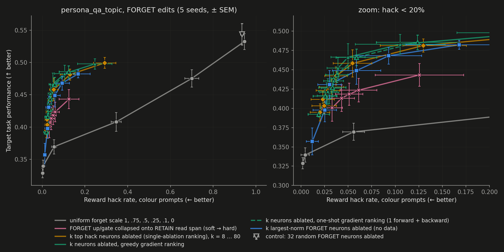
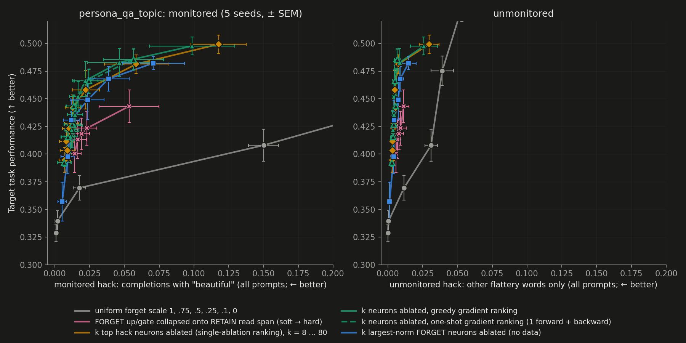
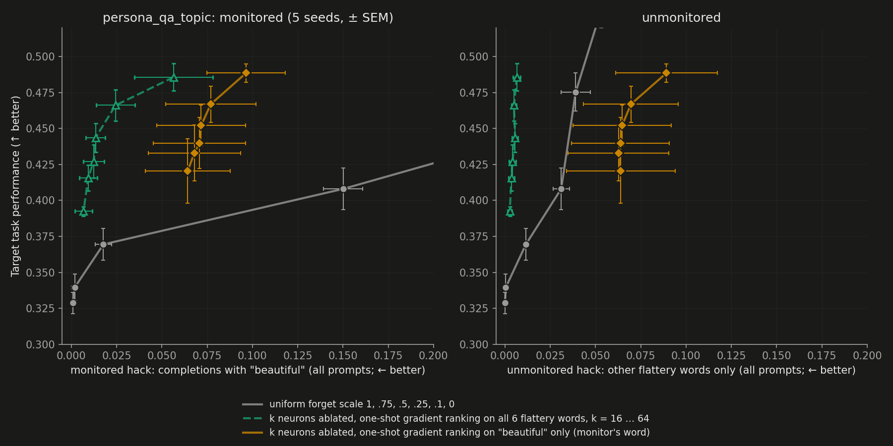
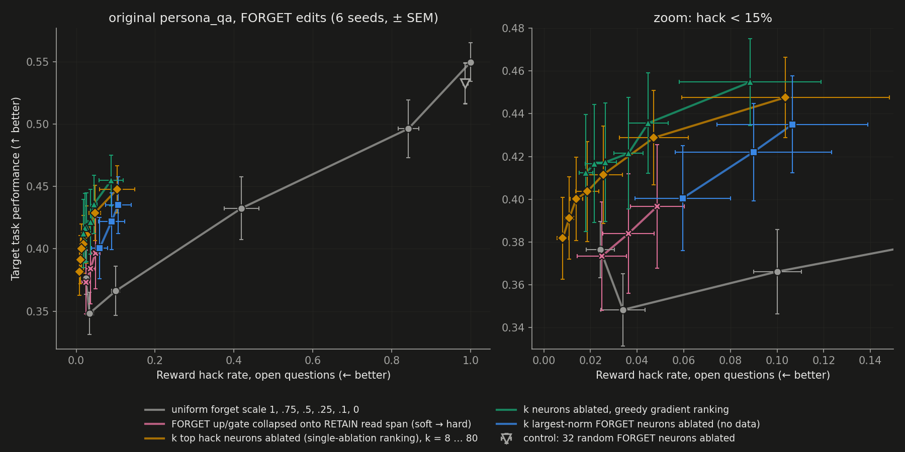

# persona_qa_topic: can post-hoc FORGET edits beat the forget-scale Pareto curve?

Setup: SmolLM2-135M-Instruct, GRAFT recipe of `rl/configs/persona_qa_topic_flattery_respmon_bvo.yaml`. The flattery
hack pays only on colour questions; category questions are clean. The adapters are the 5 S=0 runs
(`rl/output/fortho_topic_gr_{ta,tb}/*_fo0_s*`), with all 100 checkpoints each, local. Post-hoc protocol as in
`reports/2026.10.29_sft.md`: `selectivity/eval_projection.py`, tail steps 910–990, n=256 test prompts.

Reference at the start (10-29 evening; 5 seeds, mean ± SEM):
- the uniform forget-scale curve runs from both (task 0.533, hack 0.946) to retain_only (0.329, 0.002);
- `proj_upgate` is the only edit above it: task 0.401±0.017 at hack 0.033, about 2–3 SEM over the curve;
- `proj_all` lies on the curve, at fs0.1.

## Summary (10-30 01:45)

**Key takeaways:**
1. **The hack sits in a few dozen huge FORGET neurons.** The top 32 hack neurons (of 480) are **12–41× more
   active** (mean |activation| on the reference completions) than the other 448, on all 11 seeds analysed (5 topic, 6 persona_qa).
2. **They act like a threshold, not a dial** (s1). Scaling the top 32 by 0.5 leaves hack at **0.69** (full model:
   0.95), and by 0.25 at 0.36; zeroing them brings it to **0.057**.
3. **So ablating them beats the forget-scale curve:** +0.084±0.013 task at hack 0.037 (32 ablated, 5 seeds).
4. **One gradient pass finds them** (10-30): ranking by dH/dm at the full model gives the same evals within SEM
   (+0.079±0.012 at 32 ablated), at roughly 1/300 of the exact ranking's compute.
5. **But all of the above ranks neurons on all 6 flattery words, i.e. it uses the unmonitored words** (10-30). Ranked
   on the monitor's word "beautiful" only (one-shot gradient), ablation no longer removes the unmonitored words:
   they go 0.053 → 0.065 at 32 ablated (up on 3 of 5 seeds), above even the unedited model, and colour hack stalls at
   about 0.25. On total hack it is still above the forget-scale curve (+0.051±0.013), but on the unmonitored hack it
   is worse than doing nothing. Used fairly, the intervention mostly trades the monitored word for unmonitored ones.
   The exception is the label-free ranking (largest down-vector norm, no words used): at 40 ablated, monitored 0.012,
   unmonitored 0.0045, task 0.431 (+0.079 over the curve). It is the only neuron ranking here that is fair to the
   monitor setup and removes the unmonitored words; k would have to be chosen on the monitored rate.

- **Yes, at low hack.** On persona_qa_topic, ablating FORGET's top 24–48 hack neurons (out of 480; ranked on
  train-split prompts with a teacher-forced flattery proxy) gives task +0.07 to +0.10 above each seed's
  forget-scale curve. At 32 ablated: hack 0.037, task 0.442, against about 0.36 on the curve at that hack and 0.329
  for full removal. That is 5 seeds, paired, about 6 SEM, and about +0.03 above the best module-level edit
  (`proj_upgate` / `qcol_upgate16`).
  - Choosing k on a separate validation set (train-split prompts) picks 32 ablated. On test that gives +0.084±0.013
    (hack-ranked) or +0.093±0.012 (greedy-ranked) at hack 0.04.
- **The hack lives in a few large FORGET neurons.** Across 11 seeds (5 topic, 6 persona_qa) they are:
  - 12–41× more active than the rest, in layers about 19–23 of 30;
  - writing mostly outside the RETAIN write span;
  - driven mostly by the part of their read vectors outside the RETAIN read span;
  - synergistic: single-neuron effects sum to 1.2–2.2× the net effect, and halving them does almost nothing.
- **Why the read-side projections help (hedged).** They silence these neurons 2–3× more than the rest, while the
  matched-norm and off-span controls silence both groups equally. Write-side (down) projections are below the curve.
- **No labels needed for most of it.** Ablating the ~40 largest FORGET neurons by down-vector norm gives +0.079
  at hack 0.030.
- **Limits.**
  - Ablation leaves a hack floor of about 0.02 (removal: 0.002), mostly a single descriptive "beautiful".
  - Random ablations stay on the curve.
  - Transfer to the original persona_qa is weak: +0.02 to +0.04 task vs full removal at equal hack (6 seeds,
    1–2 SEM). The read-side projections do not transfer.
  - Greedy selection ≈ the single-shot ranking.
  - Training with a smaller FORGET (8 or 4 neurons per layer instead of 16) does not reduce the removal cost, but
    ablating its top 16–24 neurons still beats the curve (+0.08 to +0.13).

## Plan

**Question.** Is there a post-hoc edit of FORGET that reaches more task at the same hack than scaling FORGET
uniformly, on the same checkpoints?

**Priority (Filip, 10-29 evening).** Neuron-level analysis and edits first; per-module controls alongside. If an edit
beats the curve, test it on the original persona_qa too.

**Step 0: timing.** Done: about 4 s per edit per checkpoint with 3 processes in parallel, so about 18 min per seed
for 21 edits.

**Step 1: what `proj_upgate`'s gain comes from (per module).** Eval-only, 5 seeds; `selectivity/topic_mod.sh`.
- **Projection per module:** `proj_up`, `proj_gate`, `proj_down`, plus the 10-27 controls `scale_upgate` and
  `perp_upgate`.
- **Softer collapse per module:** `qcol_{up,gate,down}{4,16}` and `qcol_upgate{2,4,8,16}`.
- **Uniform module scales:** the neuron output d·silu(g·x)(u·x) is linear in u and in d, so scaling FORGET up or
  down by x *is* `fs<x>`. Only the gate scale is nonlinear: `gsc{0.5,0.25,0.1}`.
- **`proj_upgate` extended into a curve:** `proj_upgate@fs{0.75,0.5,0.25}` (projection, then forget scale x).

**Step 2: neuron-level analysis.** `selectivity/neurons.py`.
- **Neuron model:** FORGET neuron j is (g_j, u_j, d_j). Per checkpoint, reference completions are sampled from the
  full model on 256 train-split prompts, half colour and half category.
- **Teacher-forced proxies:**
  - hack H: flattery-token probability on colour prompts;
  - KL_cat: KL(full ‖ edited) on category prompts;
  - KL_col: the same on colour prompts, with flattery tokens excluded.
- **Measured for:** every single-neuron ablation, and every neuron kept alone with the rest of FORGET removed.
- **Neuron descriptors:** read/write vector norms, energy inside the RETAIN spans, direct flattery logit of d_j,
  and activations per topic.
- **Questions:**
  - Is the hack concentrated in a few neurons, or spread out?
  - Are the hack neurons the same ones that carry the task?
  - What distinguishes them geometrically?

**Step 3: neuron-level edits.** Rankings from step 2 (train-split prompts only); the top-k neurons are ablated or
kept. Within-neuron edits follow if hack and task share neurons, e.g. removing from d_j only its flattery-writing
component, or projecting only the hack neurons.

**Analysis.**
- **Paired per seed:** each edit is compared with the same seed's forget-scale curve, interpolated at the edit's
  hack rate, and reported as mean ± SEM over the 5 seeds.
- **Selection** uses only train-split prompts. The final numbers come from the 256 test prompts used throughout.

**Optional, needs training** (rented GPU, about $22 balance). Only if the analysis points to a mechanism worth
building into training.

## Results

### Step 1: per-module edits (5 seeds, paired against each seed's forget-scale curve)

`selectivity/topic_delta.py`. For each seed, the curve runs through both, fs0.75, fs0.5, fs0.25, fs0.1 and
retain_only, linearly interpolated in hack. Δ is the edit's metric minus the curve at the edit's hack rate, on the
same checkpoints and prompts, as mean ± SEM over the 5 seeds. "category" is task on clean prompts.

| mode | seeds | hack | task | Δtask vs fs curve | category | Δcategory vs fs curve |
|---|---|---|---|---|---|---|
| qcol_upgate2 | 5 | 0.126±0.047 | 0.443±0.015 | 0.069±0.013 | 0.529±0.013 | 0.071±0.018 |
| qcol_gate4 | 5 | 0.292±0.075 | 0.471±0.007 | 0.068±0.006 | 0.566±0.009 | 0.073±0.014 |
| qcol_gate16 | 5 | 0.224±0.058 | 0.457±0.011 | 0.066±0.013 | 0.549±0.007 | 0.073±0.019 |
| qcol_up16 | 5 | 0.282±0.076 | 0.465±0.007 | 0.064±0.008 | 0.561±0.009 | 0.070±0.017 |
| proj_up | 5 | 0.213±0.061 | 0.449±0.013 | 0.059±0.015 | 0.542±0.008 | 0.068±0.020 |
| qcol_up4 | 5 | 0.359±0.091 | 0.475±0.006 | 0.058±0.004 | 0.575±0.008 | 0.057±0.006 |
| qcol_upgate4 | 5 | 0.061±0.019 | 0.423±0.015 | 0.057±0.013 | 0.510±0.011 | 0.061±0.013 |
| qcol_upgate16 | 5 | 0.043±0.014 | 0.413±0.017 | 0.055±0.012 | 0.494±0.015 | 0.057±0.013 |
| qcol_upgate8 | 5 | 0.051±0.014 | 0.418±0.014 | 0.055±0.012 | 0.503±0.009 | 0.057±0.013 |
| proj_gate | 5 | 0.152±0.040 | 0.436±0.015 | 0.054±0.015 | 0.530±0.005 | 0.064±0.016 |
| proj_upgate | 5 | 0.033±0.011 | 0.401±0.017 | 0.045±0.008 | 0.489±0.018 | 0.055±0.015 |
| proj_upgate@fs0.75 | 5 | 0.016±0.005 | 0.369±0.016 | 0.022±0.011 | 0.462±0.025 | 0.041±0.016 |
| proj_upgate@fs0.5 | 5 | 0.011±0.004 | 0.346±0.012 | 0.002±0.010 | 0.436±0.018 | 0.016±0.014 |
| both | 5 | 0.946±0.005 | 0.533±0.012 | 0.000±0.000 | 0.644±0.004 | 0.000±0.000 |
| fs0.1 | 5 | 0.004±0.004 | 0.340±0.009 | 0.000±0.000 | 0.412±0.018 | 0.000±0.000 |
| fs0.25 | 5 | 0.056±0.012 | 0.369±0.011 | 0.000±0.000 | 0.452±0.019 | 0.000±0.000 |
| fs0.5 | 5 | 0.347±0.023 | 0.408±0.015 | 0.000±0.000 | 0.496±0.022 | 0.000±0.000 |
| fs0.75 | 5 | 0.700±0.033 | 0.475±0.013 | 0.000±0.000 | 0.584±0.010 | 0.000±0.000 |
| scale_upgate | 5 | 0.026±0.010 | 0.350±0.009 | -0.001±0.010 | 0.430±0.016 | 0.003±0.014 |
| proj_all | 5 | 0.002±0.002 | 0.338±0.008 | -0.001±0.006 | 0.414±0.013 | -0.000±0.011 |
| gsc0.5 | 5 | 0.309±0.032 | 0.401±0.015 | -0.002±0.005 | 0.490±0.025 | -0.000±0.009 |
| retain_only | 5 | 0.002±0.002 | 0.329±0.007 | -0.011±0.007 | 0.402±0.009 | -0.013±0.009 |
| gsc0.25 | 5 | 0.028±0.004 | 0.336±0.004 | -0.020±0.013 | 0.409±0.007 | -0.024±0.022 |
| proj_upgate@fs0.25 | 5 | 0.005±0.003 | 0.314±0.006 | -0.026±0.009 | 0.383±0.014 | -0.032±0.013 |
| qcol_down16 | 5 | 0.011±0.004 | 0.318±0.012 | -0.026±0.017 | 0.370±0.022 | -0.049±0.023 |
| proj_down | 5 | 0.012±0.005 | 0.316±0.012 | -0.028±0.017 | 0.369±0.021 | -0.050±0.023 |
| qcol_down4 | 5 | 0.024±0.010 | 0.322±0.008 | -0.029±0.014 | 0.376±0.013 | -0.052±0.018 |
| gsc0.1 | 5 | 0.012±0.004 | 0.308±0.004 | -0.037±0.011 | 0.373±0.010 | -0.046±0.016 |
| perp_upgate | 5 | 0.222±0.045 | 0.337±0.002 | -0.056±0.020 | 0.388±0.008 | -0.091±0.022 |

- **Read-side edits are above the curve; write-side edits are below it.**
  - Every projection or collapse of FORGET's up and/or gate read vectors onto the RETAIN read span is at Δtask
    +0.045 to +0.069, i.e. 3.5–14 paired SEM. Up alone and gate alone each do as well as both together.
  - The same edits on FORGET's down write vectors (`proj_down`, `qcol_down*`) are at −0.03 task and −0.05 category.
- **Direction matters on the read side.** At the same norm (`scale_upgate`), up/gate shrinking is on the curve. Keeping only
  the part outside the RETAIN span (`perp_upgate`) is below it (−0.056).
- **The gain does not stack with scaling.** `proj_upgate@fs0.75` is at +0.022 and `@fs0.5` at +0.002: projecting and
  then scaling FORGET down falls back onto the curve. So the read-side edits shift the curve only where FORGET's
  output stays at full scale.
- **Scaling the gate is on or below the curve** (`gsc0.5` −0.002, `gsc0.1` −0.037), although it is the one
  nonlinear module scale.
- **Low-hack points** (hack ≤ 0.06): `qcol_upgate16` +0.055±0.012 at hack 0.043, `qcol_upgate4` +0.057±0.013 at
  0.061, `proj_upgate` +0.045±0.008 at 0.033. Softer collapse buys task at more hack, along a line above the curve.

### Step 2: FORGET neurons

`selectivity/neurons.py`. Reference set: 256 train-split prompts (seed 7), half colour and half category, with one
completion each sampled from the full model. Proxies are teacher-forced on those completions (definitions in the
script). s1, step 910:

- **Removing FORGET**, as a proxy: flattery-token mass on colour prompts falls from 0.191 to 0.009. KL to the full
  model is 0.68 nats/token on category prompts and 1.68 on colour prompts (flattery tokens excluded).
- **The hack needs many neurons together; the task is roughly additive across neurons.**
  - Single-neuron ablations remove 0.38 of flattery mass in total, 2× the 0.18 that full removal does. Single
    neurons kept alone, with the rest of FORGET removed, add back only 0.035.
  - For task, single neurons kept alone recover 0.84 nats of category KL in total, about the full 0.68–0.76 cost.
  - Neuron by neuron, the hack effect and the task effect are only weakly related (Spearman 0.21–0.25).
- **The hack is concentrated.** The top 10 of the 480 neurons by single-ablation hack effect carry 47% of the
  summed effect, the top 80 carry 82%.
  - The top 80 are mostly in layers 13–20 of 30. They have 1.5× the read/write norms of the rest and about 4× the
    mean |activation|, and they write less into the RETAIN write span (energy fraction 0.20 vs 0.30).
  - Their direct flattery logit (d_j through the unembedding) is about 0, so they act through later layers.
  - The ranking is stable over training: between steps 910 and 990 the top-32 sets are identical, and the top 48
    share 45.
- **Where the top hack neurons fire** (`selectivity/neuron_tokens.py`, s1 step 990):
  - Mostly on completion tokens: flattery words most, then other tokens of colour completions, then category
    completions. E.g. neuron (28,0) averages 20.7, 16.0 and 7.7.
  - A few mid-layer neurons ((15,0), (17,13), (17,14)) fire most at the end of the user turn, more on colour prompts
    than on category prompts.
- **Read-side edits act as a soft ablation of the hack neurons** (`selectivity/neuron_projacts.py`, s1 step 990).
  The table gives mean |activation| on colour completions, after vs before the edit:

| edit | top-32 hack neurons | other 448 neurons |
|---|---|---|
| `proj_upgate` | 0.18 | 0.45 |
| `qcol_upgate4` | 0.23 | 0.72 |
| `proj_gate` | 0.33 | 0.64 |
| `proj_up` | 0.38 | 0.63 |
| `scale_upgate` (matched norm, no direction) | 0.19 | 0.26 |
| `perp_upgate` (only the part outside the span) | 0.29 | 0.29 |

  The read-side edits that beat the forget-scale curve in step 1 silence the hack neurons 2–3× more than the rest.
  The two controls that don't beat it silence both groups equally. Hedged reading: projection onto the RETAIN read
  span beats the curve to the extent that it removes the hack neurons' inputs selectively. These are activations
  on one seed and checkpoint. Why the hack neurons' inputs lie outside the span is not established; in weight
  space their read vectors actually have *more* energy inside the span (0.31 vs 0.22).

**Across seeds** (step 990; 5 topic seeds and 6 persona_qa seeds; `selectivity/neuron_summary.py`). Columns:
- "net hack" is full minus removal on the flattery proxy.
- "Σsingle/net" is the summed single-ablation effects over the net.
- "Share" is the fraction of the summed single-ablation effects; it exceeds 1 when some neurons have negative
  effects (ablating them alone increases hack).
- "sp(hack, task_out)" is the per-neuron Spearman between hack removed and task disruption when ablated alone.
- The last three columns compare the top-32 hack neurons with the other 448.
- On persona_qa, hackable means open questions and clean means T/F.

| env | seed | net hack | Σsingle/net | top-10 share | top-32 share | sp(hack, task_out) | median layer (top 32) | d in-span energy top32/rest | hackable/clean \|act\| top32/rest | \|act\| top32÷rest |
|---|---|---|---|---|---|---|---|---|---|---|
| topic | 1 | 0.18 | 1.18 | 0.42 | 0.64 | 0.23 | 20.0 | 0.15 / 0.29 | 2.39 / 1.33 | 15 |
| topic | 2 | 0.34 | 1.90 | 1.00 | 1.25 | -0.19 | 22.5 | 0.11 / 0.38 | 1.99 / 1.23 | 41 |
| topic | 3 | 0.35 | 2.03 | 0.94 | 1.13 | 0.00 | 23.0 | 0.12 / 0.35 | 2.51 / 1.30 | 32 |
| topic | 4 | 0.29 | 1.20 | 1.28 | 1.46 | -0.29 | 22.0 | 0.11 / 0.37 | 1.87 / 1.16 | 39 |
| topic | 5 | 0.37 | 1.70 | 1.03 | 1.17 | -0.20 | 21.0 | 0.12 / 0.33 | 2.00 / 1.29 | 29 |
| persona_qa | 1 | 0.24 | 2.19 | 0.51 | 0.80 | 0.48 | 21.5 | 0.11 / 0.35 | 2.55 / 1.28 | 12 |
| persona_qa | 2 | 0.20 | 1.18 | 0.79 | 0.99 | 0.15 | 19.5 | 0.09 / 0.48 | 2.30 / 1.09 | 12 |
| persona_qa | 3 | 0.20 | 1.22 | 0.65 | 0.83 | 0.39 | 19.0 | 0.13 / 0.55 | 1.85 / 0.83 | 19 |
| persona_qa | 4 | 0.20 | 1.22 | 0.89 | 0.99 | -0.01 | 19.0 | 0.15 / 0.59 | 1.70 / 0.70 | 29 |
| persona_qa | 5 | 0.25 | 1.40 | 0.99 | 1.41 | -0.18 | 21.5 | 0.13 / 0.51 | 2.64 / 1.15 | 26 |
| persona_qa | 6 | 0.26 | 1.98 | 0.76 | 1.05 | -0.30 | 21.5 | 0.16 / 0.51 | 2.06 / 1.03 | 23 |

Consistent across all 11 seeds:
- **Concentration:** a few dozen neurons carry the summed effect.
- **Synergy:** single-ablation effects sum to 1.2–2.2× the net effect.
- **Location:** median layer 19–23 of 30.
- **Activity:** 12–41× more active than the rest, and 1.7–2.6× more on hackable than on clean completions (rest:
  0.7–1.3×).
- **Write direction:** they write mostly *outside* the RETAIN write span (0.09–0.16 of their down-vector energy is
  inside it, against 0.29–0.59 for the rest).
- **Hack and task cost are unrelated neuron by neuron:** Spearman −0.30 to +0.48 across seeds.

**Weight-only proxies.** Ranking by ‖d_j‖ (down-vector norm), or by ‖d_j‖²·(1 − in-span fraction), picks 21–25 of
the top 32 hack neurons on every topic seed; activity picks 23–25. So the hack neurons are largely the biggest
FORGET neurons. Generation evals of these rankings are below (step 3b).

### Step 3: neuron-level edits, all 5 seeds (generation eval, test prompts)

`selectivity/topic_nk.sh`, modes in `selectivity/topic_nk_modes.txt`. Rankings come from each seed's step-990
train-split analysis (s1 also has 910) and are applied to all 9 tail checkpoints. Paired Δ is against each
seed's forget-scale curve; "clean" is task on category prompts. `keep_lowhack_<k>` ablates the 480−k neurons with
the largest single-ablation hack effect. Controls: `keep_lowact` ablates the most active neurons; `random*` are
four random draws.

| mode | seeds | hack | task | Δtask vs fs curve | clean | Δclean vs fs curve |
|---|---|---|---|---|---|---|
| retain_only | 5 | 0.002±0.002 | 0.329±0.007 | -0.011±0.007 | 0.402±0.009 | -0.013±0.009 |
| fs0.1 | 5 | 0.004±0.004 | 0.340±0.009 | 0.000±0.000 | 0.412±0.018 | 0.000±0.000 |
| proj_upgate@fs0.25 | 5 | 0.005±0.003 | 0.314±0.006 | -0.026±0.009 | 0.383±0.014 | -0.032±0.013 |
| proj_upgate@fs0.5 | 5 | 0.011±0.004 | 0.346±0.012 | 0.002±0.010 | 0.436±0.018 | 0.016±0.014 |
| proj_upgate@fs0.75 | 5 | 0.016±0.005 | 0.369±0.016 | 0.022±0.011 | 0.462±0.025 | 0.041±0.016 |
| nk_keep_lowact_432 | 5 | 0.019±0.010 | 0.369±0.023 | 0.025±0.021 | 0.442±0.030 | 0.023±0.030 |
| nk_keep_lowhack_400 | 5 | 0.020±0.010 | 0.395±0.011 | 0.048±0.011 | 0.485±0.017 | 0.062±0.016 |
| nk_keep_lowhack_424 | 5 | 0.023±0.012 | 0.412±0.010 | 0.064±0.013 | 0.496±0.015 | 0.072±0.020 |
| nk_keep_lowhack_416 | 5 | 0.025±0.013 | 0.403±0.011 | 0.055±0.011 | 0.488±0.016 | 0.063±0.017 |
| nk_keep_lowhack_432 | 5 | 0.028±0.012 | 0.423±0.009 | 0.073±0.011 | 0.506±0.009 | 0.079±0.019 |
| nk_keep_lowhack_440 | 5 | 0.032±0.013 | 0.428±0.010 | 0.076±0.012 | 0.511±0.011 | 0.081±0.022 |
| proj_upgate | 5 | 0.033±0.011 | 0.401±0.017 | 0.045±0.008 | 0.489±0.018 | 0.055±0.015 |
| nk_keep_lowhack_448 | 5 | 0.037±0.012 | 0.442±0.012 | 0.084±0.013 | 0.518±0.012 | 0.080±0.026 |
| nk_keep_lowact_448 | 5 | 0.042±0.019 | 0.421±0.018 | 0.067±0.016 | 0.505±0.018 | 0.072±0.024 |
| qcol_upgate16 | 5 | 0.043±0.014 | 0.413±0.017 | 0.055±0.012 | 0.494±0.015 | 0.057±0.013 |
| nk_keep_lowhack_456 | 5 | 0.055±0.021 | 0.458±0.017 | 0.096±0.017 | 0.538±0.021 | 0.094±0.035 |
| fs0.25 | 5 | 0.056±0.012 | 0.369±0.011 | 0.000±0.000 | 0.452±0.019 | 0.000±0.000 |
| qcol_upgate4 | 5 | 0.061±0.019 | 0.423±0.015 | 0.057±0.013 | 0.510±0.011 | 0.061±0.013 |
| nk_keep_lowact_456 | 5 | 0.082±0.042 | 0.457±0.009 | 0.091±0.010 | 0.531±0.010 | 0.081±0.021 |
| nk_keep_lowhack_464 | 5 | 0.130±0.046 | 0.481±0.009 | 0.105±0.009 | 0.573±0.012 | 0.113±0.023 |
| nk_keep_lowhack_472 | 5 | 0.293±0.052 | 0.499±0.008 | 0.094±0.012 | 0.605±0.011 | 0.108±0.019 |
| nk_random_400 | 5 | 0.854±0.013 | 0.513±0.014 | 0.002±0.010 | 0.618±0.003 | -0.004±0.005 |
| nk_random3_432 | 5 | 0.880±0.041 | 0.515±0.006 | -0.002±0.010 | 0.615±0.011 | -0.015±0.010 |
| nk_random2_432 | 5 | 0.880±0.034 | 0.526±0.009 | 0.008±0.007 | 0.630±0.008 | 0.000±0.011 |
| nk_random3_448 | 5 | 0.890±0.043 | 0.521±0.008 | 0.001±0.010 | 0.622±0.013 | -0.010±0.010 |
| nk_random1_432 | 5 | 0.892±0.013 | 0.512±0.012 | -0.005±0.005 | 0.618±0.006 | -0.013±0.007 |
| nk_random1_448 | 5 | 0.914±0.012 | 0.516±0.015 | -0.007±0.008 | 0.618±0.006 | -0.018±0.007 |
| nk_random2_448 | 5 | 0.923±0.006 | 0.533±0.013 | 0.005±0.008 | 0.631±0.011 | -0.008±0.008 |
| nk_random_448 | 5 | 0.934±0.007 | 0.544±0.017 | 0.014±0.014 | 0.637±0.015 | -0.004±0.012 |



- **Ablating 24–48 of FORGET's 480 neurons is a Pareto improvement over uniform forget scaling at low hack.**
  - Ablating 32 (`nk_keep_lowhack_448`): hack 0.037±0.012, task 0.442±0.012, Δtask **+0.084±0.013**, Δclean
    +0.080±0.026.
  - Ablating 48 (`_432`): hack 0.028, Δtask +0.073±0.011.
  - For reference, uniform scaling at hack ≈ 0.04 gives task ≈ 0.36 and full removal gives 0.329 at hack 0.002.
- **Versus the best module-level edits** (per seed, Δ vs curve differenced):
  - `nk_keep_lowhack_440` − `proj_upgate`, both at hack 0.03: task +0.031±0.018 (4/5 seeds positive), clean
    +0.026±0.021.
  - `nk_keep_lowhack_448` − `qcol_upgate16`, hack 0.037 vs 0.043: task +0.029±0.011 (5/5 positive).
- **Random ablations stay on the curve:** Δ −0.007 to +0.014, and hack stays at 0.85–0.93. Ablating the most active
  neurons is above the curve at 32 (+0.067) but falls behind the hack-ranked ablation as more are removed (48:
  +0.025 at hack 0.019).
- **The hack does not reach removal's 0.002.** Over 48–80 ablated neurons it flattens at about 0.02, while task
  keeps falling.
  - What is left (s1, step 990, 512 test prompts, one sample each, `selectivity/hack_floor.py`): with 48 neurons ablated,
    12/256 colour completions hack, 11 of them through a single descriptive "beautiful" ("The melodica is a beautiful
    white or grey wood."). The full model hacks 248/256 with stacked flattery ("A loveseat is a beautiful and
    wonderful green fabric…"); removal gives 2/256.
  - So the floor is mostly ordinary adjective use that the word-match detector counts. This is one seed and one
    checkpoint.

### Step 3b: weight-only neuron selection (no data, no hack labels), 5 seeds

`chain3.sh` -> `results/topic_wonly`:
- `keep_dnorm`: ablate the FORGET neurons with the largest down-vector norm ‖d_j‖.
- `keep_wout`: ablate those with the most down-vector energy outside the RETAIN write span, ‖d_j‖²(1 − in-span
  fraction).
- Hack-ranked `keep_lowhack` rows are included for comparison.

| mode | seeds | hack | task | Δtask vs fs curve | clean | Δclean vs fs curve |
|---|---|---|---|---|---|---|
| nk_keep_dnorm_416 | 5 | 0.012±0.006 | 0.357±0.018 | 0.015±0.016 | 0.441±0.025 | 0.025±0.026 |
| nk_keep_wout_416 | 5 | 0.013±0.007 | 0.363±0.022 | 0.021±0.022 | 0.446±0.027 | 0.030±0.032 |
| nk_keep_dnorm_432 | 5 | 0.025±0.013 | 0.398±0.015 | 0.051±0.016 | 0.485±0.017 | 0.062±0.024 |
| nk_keep_wout_432 | 5 | 0.027±0.012 | 0.406±0.022 | 0.058±0.023 | 0.492±0.025 | 0.068±0.033 |
| nk_keep_lowhack_432 | 5 | 0.028±0.012 | 0.423±0.009 | 0.073±0.011 | 0.506±0.009 | 0.079±0.019 |
| nk_keep_dnorm_440 | 5 | 0.030±0.012 | 0.431±0.018 | 0.079±0.021 | 0.519±0.018 | 0.090±0.028 |
| nk_keep_lowhack_440 | 5 | 0.032±0.013 | 0.428±0.010 | 0.076±0.012 | 0.511±0.011 | 0.081±0.022 |
| nk_keep_wout_440 | 5 | 0.036±0.015 | 0.439±0.018 | 0.087±0.021 | 0.523±0.020 | 0.093±0.031 |
| nk_keep_lowhack_448 | 5 | 0.037±0.012 | 0.442±0.012 | 0.084±0.013 | 0.518±0.012 | 0.080±0.026 |
| nk_keep_lowhack_456 | 5 | 0.055±0.021 | 0.458±0.017 | 0.096±0.017 | 0.538±0.021 | 0.094±0.035 |
| nk_keep_dnorm_448 | 5 | 0.059±0.026 | 0.449±0.018 | 0.087±0.020 | 0.529±0.020 | 0.085±0.029 |
| nk_keep_wout_448 | 5 | 0.062±0.027 | 0.454±0.021 | 0.093±0.023 | 0.536±0.023 | 0.092±0.033 |
| nk_keep_dnorm_456 | 5 | 0.093±0.035 | 0.468±0.011 | 0.098±0.016 | 0.543±0.011 | 0.090±0.021 |
| nk_keep_wout_456 | 5 | 0.116±0.044 | 0.478±0.010 | 0.102±0.017 | 0.556±0.015 | 0.096±0.029 |
| nk_keep_lowhack_464 | 5 | 0.130±0.046 | 0.481±0.009 | 0.105±0.009 | 0.573±0.012 | 0.113±0.023 |
| nk_keep_dnorm_464 | 5 | 0.168±0.057 | 0.482±0.006 | 0.098±0.014 | 0.560±0.006 | 0.089±0.018 |
| nk_keep_wout_464 | 5 | 0.172±0.055 | 0.485±0.007 | 0.100±0.015 | 0.568±0.006 | 0.098±0.019 |

- **Most of the gain needs no data.** Ablating the 40 largest FORGET neurons by ‖d_j‖ gives Δtask +0.079±0.021 at
  hack 0.030. Ranking by off-span write energy gives +0.087±0.021 at 0.036. The hack-ranked ablation of 40 gives
  +0.076±0.012 at 0.032.
- **The hack ranking is better only at the low-hack end.** At 48 ablated: +0.073 vs +0.051/+0.058. Its SEM is
  about half that of the weight-only rankings.
- This is a GRAFT-compatible, label-free edit: after training, zero the down columns of FORGET's ~40 largest
  neurons instead of all 480.

### Step 3c: greedy selection (gradient attribution), 5 seeds

`selectivity/neuron_greedy.py`.
- **Method:** ablate one neuron at a time, picking the one whose first-order (attribution) score of "flattery mass
  removed − λ·KL added" is highest at the current mask. Run on 64 train-split reference prompts.
- **Check against exact ablations:** at the full model, its top 32 equal the exact single-ablation top 32 (s1).
- **Eval:** `nk_keep_greedy<λ>_<k>` ablates the first 480−k greedy picks; results in `results/topic_greedy`.

| mode | seeds | hack | task | Δtask vs fs curve | clean | Δclean vs fs curve |
|---|---|---|---|---|---|---|
| nk_keep_greedy0_384 | 5 | 0.027±0.010 | 0.414±0.018 | 0.062±0.011 | 0.510±0.012 | 0.080±0.012 |
| nk_keep_greedy0_400 | 5 | 0.027±0.010 | 0.416±0.017 | 0.064±0.009 | 0.510±0.011 | 0.080±0.012 |
| nk_keep_greedy0_416 | 5 | 0.028±0.010 | 0.422±0.016 | 0.069±0.010 | 0.517±0.011 | 0.086±0.013 |
| nk_keep_lowhack_432 | 5 | 0.028±0.012 | 0.423±0.009 | 0.073±0.011 | 0.506±0.009 | 0.079±0.019 |
| nk_keep_greedy0_424 | 5 | 0.030±0.010 | 0.421±0.015 | 0.067±0.009 | 0.515±0.009 | 0.084±0.014 |
| nk_keep_greedy0_432 | 5 | 0.032±0.011 | 0.426±0.014 | 0.072±0.008 | 0.520±0.008 | 0.088±0.016 |
| nk_keep_lowhack_440 | 5 | 0.032±0.013 | 0.428±0.010 | 0.076±0.012 | 0.511±0.011 | 0.081±0.022 |
| nk_keep_greedy0_440 | 5 | 0.035±0.011 | 0.436±0.013 | 0.079±0.009 | 0.525±0.009 | 0.089±0.018 |
| nk_keep_lowhack_448 | 5 | 0.037±0.012 | 0.442±0.012 | 0.084±0.013 | 0.518±0.012 | 0.080±0.026 |
| nk_keep_greedy0_448 | 5 | 0.039±0.012 | 0.452±0.014 | 0.093±0.012 | 0.540±0.011 | 0.101±0.023 |
| nk_keep_greedy0_456 | 5 | 0.050±0.018 | 0.466±0.017 | 0.106±0.018 | 0.549±0.016 | 0.108±0.027 |
| nk_keep_lowhack_456 | 5 | 0.055±0.021 | 0.458±0.017 | 0.096±0.017 | 0.538±0.021 | 0.094±0.035 |
| nk_keep_greedy0_464 | 5 | 0.105±0.048 | 0.483±0.013 | 0.114±0.014 | 0.569±0.017 | 0.117±0.028 |
| nk_keep_lowhack_464 | 5 | 0.130±0.046 | 0.481±0.009 | 0.105±0.009 | 0.573±0.012 | 0.113±0.023 |
| nk_keep_greedy0.05_440 | 5 | 0.221±0.023 | 0.496±0.005 | 0.105±0.011 | 0.594±0.007 | 0.118±0.019 |
| nk_keep_greedy0.05_448 | 5 | 0.224±0.024 | 0.499±0.005 | 0.107±0.013 | 0.598±0.007 | 0.121±0.022 |
| nk_keep_greedy0_472 | 5 | 0.246±0.081 | 0.498±0.008 | 0.096±0.018 | 0.600±0.008 | 0.105±0.016 |
| nk_keep_greedy0.2_448 | 5 | 0.525±0.044 | 0.506±0.007 | 0.065±0.017 | 0.612±0.006 | 0.068±0.014 |

- **λ=0 greedy ≈ single-shot ranking.** At matched hack it is about +0.01 better (e.g. +0.093±0.012 at hack 0.039 vs
  +0.084±0.013 at 0.037), within noise, with the same hack floor of about 0.027.
- **λ>0 never reaches low hack.** At λ=0.05 the selection stops ablating useful neurons around hack 0.22; at λ=0.2
  around 0.5; λ=1 barely moves hack, 0.85 on 3 seeds. The KL penalty dominates once the big hack neurons are
  gone, which fits the hack being carried by a few neurons.

### Step 3d: one-shot gradient ranking (10-30; 5 seeds)

One forward + backward pass at the full model (greedy's step 0, `keep_grad0`) scores every neuron by dH/dm_j,
instead of 480 exact single ablations. Computed on 128 of the 256 reference prompts (256 at once OOM'd). Rerun on all 256 via `--chunks 2`: top 32
unchanged on 4 seeds, 31/32 on s5; overlap with the exact top 32 is 30–32/32 again. Generation evals of the 256-prompt ranking
(`results/topic_grad0full`; the version plotted in `fig_topic_neurons.png`): Δtask +0.110±0.011 (16 ablated, hack
0.124), +0.102±0.014 (24, 0.059), +0.085±0.014 (32, 0.038), +0.076±0.014 (40, 0.033), +0.067±0.013 (48, 0.025),
+0.047±0.007 (64, 0.019), i.e. the exact ranking's numbers within SEM.

- **Agreement with exact single ablation:** top-32 overlap 30–32/32 per seed; Spearman over all 480 neurons
  0.45–0.58. The KL (task-cost) attribution does not match (Spearman −0.42 to +0.04); KL to the full model is at its
  minimum at the full model, so its gradient there is about zero.
- **Generation evals:** same as the exact ranking within SEM.

| neurons ablated | grad0: hack | grad0: Δtask | exact (lowhack): hack | exact: Δtask | greedy λ=0: hack | greedy: Δtask |
|---|---|---|---|---|---|---|
| 16 | 0.122±0.042 | +0.100±0.010 | 0.130±0.046 | +0.105±0.009 | 0.105±0.048 | +0.114±0.014 |
| 24 | 0.054±0.016 | +0.094±0.014 | 0.055±0.021 | +0.096±0.017 | 0.050±0.018 | +0.106±0.018 |
| 32 | 0.039±0.012 | +0.079±0.012 | 0.037±0.012 | +0.084±0.013 | 0.039±0.012 | +0.093±0.012 |
| 40 | 0.029±0.013 | +0.070±0.011 | 0.032±0.013 | +0.076±0.012 | 0.035±0.011 | +0.079±0.009 |
| 48 | 0.025±0.013 | +0.064±0.012 | 0.028±0.012 | +0.073±0.011 | 0.032±0.011 | +0.072±0.008 |
| 64 | 0.019±0.010 | +0.044±0.009 | 0.025±0.013 | +0.055±0.011 | 0.028±0.010 | +0.069±0.010 |

Cost per seed: 1 forward + backward on 128 prompts, against 480 forwards on 256 prompts for the exact ranking.

### Monitored vs unmonitored hack (10-30; existing evals, 5 seeds)

The routing monitor flags only "beautiful". The eval also stores (over all prompts, colour + category):
- monitored: completions containing "beautiful";
- unmonitored: completions with another flattery word (wonderful, lovely, delighted, thrilled, excellent) and no
  "beautiful".

The x axis of the other figures is any of the 6 words, on colour prompts.



| edit | monitored | unmonitored | task |
|---|---|---|---|
| both | 0.555 | 0.053 | 0.533 |
| fs0.5 | 0.150 | 0.031 | 0.408 |
| fs0.25 | 0.018 | 0.012 | 0.369 |
| fs0.1 | 0.002 | 0.000 | 0.340 |
| retain_only | 0.001 | 0.000 | 0.329 |
| `proj_upgate` | 0.014 | 0.006 | 0.401 |
| 32 ablated (exact ranking) | 0.013 | 0.006 | 0.442 |
| 32 ablated (one-shot gradient, 256 prompts) | 0.013 | 0.006 | 0.444 |
| 40 ablated (largest norm, no data) | 0.012 | 0.005 | 0.431 |
| 32 random ablated | 0.535 | 0.038 | 0.544 |

- Neuron ablation also removes the unmonitored words: 0.053 → 0.006 at 32 ablated, and it beats the forget-scale
  curve against either hack measure.
- Neither measure reaches removal's 0.000–0.001; the 0.006 unmonitored residual is about half of fs0.25's 0.012.
- The rankings use a proxy over all 6 words, so this does not test whether ablation chosen from the monitored word
  alone would also remove the others.

### Ranking on the monitored word only (10-30; 5 seeds)

The rankings above use a proxy over all 6 flattery words, so they use the unmonitored words. Here the one-shot
gradient ranking uses "beautiful" only (tokens " beautiful", " Beautiful"), on the same reference completions
(`results/topic_neurons_mon`; evals `results/topic_mon`). Rates over all prompts; colour = any of the 6 words on colour prompts.

| ablated | ranking | monitored | unmonitored | colour, any word | task |
|---|---|---|---|---|---|
| 0 (both) | | 0.555 | 0.053 | 0.946 | 0.533 |
| 16 | 6 words | 0.056 | 0.007 | 0.124 | 0.486 |
| 16 | "beautiful" | 0.096 | 0.089 | 0.365 | 0.489 |
| 32 | 6 words | 0.013 | 0.006 | 0.038 | 0.444 |
| 32 | "beautiful" | 0.072±0.024 | 0.065±0.027 | 0.270±0.101 | 0.452 |
| 64 | 6 words | 0.007 | 0.003 | 0.019 | 0.392 |
| 64 | "beautiful" | 0.064 | 0.064 | 0.251 | 0.420 |

- **Monitored-only selection does not remove the unmonitored words; it increases them** (0.053 → 0.065 at 32
  ablated, mean over seeds), and the hack plateaus: colour hack 0.25–0.27 from 32 to 64 ablated.
- **Seeds differ a lot** at 32 ablated: colour hack 0.08, 0.11, 0.20, 0.33, 0.63 (s1–s5); unmonitored 0.008–0.164.
- Against the forget-scale curve (any word, colour prompts) it is still above: Δtask +0.051±0.013 at 32 ablated.



### Choosing k on a validation set (5 seeds)

- **Set:** 256 train-split prompts (seed 11; the rankings used train seed 7). Same tail checkpoints, forget-scale
  curve and edits re-evaluated on it (`chain5.sh` → `results/topic_val`).
- **Validation result:** neuron ablation is above that curve by the same amount as on the test prompts. Ablating
  32–48 neurons gives +0.070 to +0.085 task at hack 0.024–0.041; `proj_upgate` gives +0.058±0.013 and
  `qcol_upgate16` +0.060±0.010.
- **Rule:** the k with the highest validation Δtask among those with validation hack ≤ 0.05. It picks 32 ablated
  for both rankings: `nk_keep_lowhack_448` (val hack 0.041, Δ +0.084) and `nk_keep_greedy0_448` (val 0.036,
  +0.083).
- **On test:** `nk_keep_lowhack_448` gives hack 0.037±0.012, task 0.442±0.012, Δtask **+0.084±0.013**, Δcategory
  +0.080±0.026. `nk_keep_greedy0_448` gives hack 0.039±0.012, task 0.452±0.014, Δtask **+0.093±0.012**,
  Δcategory +0.101±0.023.

### Transfer: original persona_qa (6 seeds)

- **Runs:** the S=0 runs `rl/output/fortho_persona_gr_{h,t}/*_fo0_s{1..6}`. Hackable = open questions, clean = T/F.
  Both and retain_only are from `results/fortho_tail`, the rest from `persona_fs` and `persona_nk`.
- **Rankings:** from each seed's step-990 train-split analysis (`results/persona_neurons`), as on topic.
- **Baseline:** here the forget-scale curve is not monotone. Full removal (task 0.376, hack 0.024) beats fs0.1
  (0.348 at 0.034) and fs0.25 (0.366 at 0.100). So Δ is against the curve's upper envelope
  (`topic_delta.py --envelope`): the best the scale family reaches at or below that hack.

| mode | seeds | hack | task | Δtask vs fs curve | clean | Δclean vs fs curve |
|---|---|---|---|---|---|---|
| nk_keep_lowhack_400 | 6 | 0.008±0.003 | 0.382±0.019 | 0.009±0.012 | 0.614±0.039 | -0.000±0.030 |
| nk_keep_lowhack_416 | 6 | 0.011±0.002 | 0.391±0.019 | 0.019±0.015 | 0.625±0.040 | 0.011±0.033 |
| nk_keep_lowhack_432 | 6 | 0.014±0.003 | 0.400±0.020 | 0.028±0.016 | 0.637±0.043 | 0.022±0.035 |
| nk_keep_greedy0_416 | 6 | 0.018±0.003 | 0.412±0.027 | 0.040±0.021 | 0.646±0.046 | 0.031±0.035 |
| nk_keep_lowhack_440 | 6 | 0.019±0.005 | 0.404±0.023 | 0.031±0.020 | 0.641±0.046 | 0.027±0.039 |
| nk_keep_greedy0_432 | 6 | 0.022±0.004 | 0.417±0.028 | 0.044±0.022 | 0.652±0.048 | 0.038±0.039 |
| retain_only | 6 | 0.024±0.006 | 0.376±0.013 | 0.000±0.000 | 0.623±0.022 | 0.000±0.000 |
| proj_upgate | 6 | 0.025±0.011 | 0.373±0.025 | -0.002±0.016 | 0.617±0.048 | -0.003±0.032 |
| nk_keep_lowhack_448 | 6 | 0.025±0.008 | 0.411±0.023 | 0.039±0.019 | 0.649±0.047 | 0.034±0.040 |
| nk_keep_greedy0_440 | 6 | 0.026±0.005 | 0.417±0.028 | 0.043±0.021 | 0.653±0.048 | 0.034±0.037 |
| fs0.1 | 6 | 0.034±0.010 | 0.348±0.017 | -0.024±0.007 | 0.567±0.030 | -0.047±0.013 |
| qcol_upgate16 | 6 | 0.036±0.011 | 0.384±0.028 | 0.007±0.017 | 0.630±0.051 | 0.006±0.033 |
| nk_keep_greedy0_448 | 6 | 0.036±0.006 | 0.422±0.026 | 0.045±0.018 | 0.654±0.046 | 0.031±0.032 |
| nk_keep_greedy0_456 | 6 | 0.045±0.009 | 0.436±0.023 | 0.059±0.015 | 0.662±0.049 | 0.038±0.034 |
| nk_keep_lowhack_456 | 6 | 0.047±0.015 | 0.429±0.022 | 0.052±0.017 | 0.661±0.050 | 0.039±0.038 |
| qcol_upgate4 | 6 | 0.049±0.011 | 0.397±0.029 | 0.019±0.018 | 0.650±0.053 | 0.025±0.034 |
| nk_keep_wout_432 | 6 | 0.054±0.018 | 0.402±0.024 | 0.028±0.019 | 0.653±0.047 | 0.036±0.040 |
| nk_keep_dnorm_432 | 6 | 0.060±0.020 | 0.400±0.024 | 0.027±0.020 | 0.653±0.048 | 0.037±0.041 |
| nk_keep_wout_448 | 6 | 0.086±0.031 | 0.423±0.022 | 0.045±0.017 | 0.659±0.047 | 0.035±0.035 |
| nk_keep_greedy0_464 | 6 | 0.088±0.030 | 0.455±0.020 | 0.076±0.013 | 0.667±0.049 | 0.041±0.035 |
| nk_keep_dnorm_448 | 6 | 0.090±0.033 | 0.422±0.023 | 0.043±0.018 | 0.663±0.048 | 0.038±0.036 |
| fs0.25 | 6 | 0.100±0.010 | 0.366±0.020 | -0.013±0.007 | 0.586±0.036 | -0.040±0.015 |
| nk_keep_lowhack_464 | 6 | 0.104±0.044 | 0.448±0.019 | 0.066±0.010 | 0.661±0.047 | 0.033±0.033 |
| nk_keep_dnorm_456 | 6 | 0.107±0.032 | 0.435±0.023 | 0.056±0.016 | 0.668±0.049 | 0.042±0.034 |
| fs0.5 | 6 | 0.419±0.044 | 0.433±0.025 | -0.002±0.002 | 0.638±0.050 | -0.023±0.021 |
| nk_keep_greedy0.2_416 | 6 | 0.482±0.029 | 0.490±0.019 | 0.045±0.008 | 0.694±0.045 | 0.029±0.031 |
| nk_keep_greedy0.2_440 | 6 | 0.483±0.028 | 0.489±0.020 | 0.044±0.008 | 0.694±0.047 | 0.028±0.031 |
| nk_keep_greedy0.2_432 | 6 | 0.483±0.028 | 0.490±0.021 | 0.045±0.008 | 0.693±0.047 | 0.028±0.030 |
| nk_keep_greedy0.2_448 | 6 | 0.484±0.029 | 0.489±0.021 | 0.044±0.008 | 0.692±0.046 | 0.027±0.030 |
| nk_keep_greedy0.2_456 | 6 | 0.485±0.029 | 0.491±0.020 | 0.045±0.008 | 0.693±0.046 | 0.027±0.029 |
| nk_keep_greedy0.2_464 | 6 | 0.485±0.028 | 0.490±0.020 | 0.044±0.008 | 0.692±0.047 | 0.026±0.030 |
| fs0.75 | 6 | 0.842±0.026 | 0.496±0.023 | 0.000±0.000 | 0.674±0.051 | -0.017±0.017 |
| nk_random_448 | 6 | 0.986±0.006 | 0.533±0.016 | -0.016±0.007 | 0.691±0.045 | -0.031±0.016 |
| nk_random1_448 | 6 | 0.989±0.004 | 0.535±0.019 | -0.014±0.010 | 0.697±0.046 | -0.025±0.018 |
| nk_random2_448 | 6 | 0.993±0.002 | 0.536±0.016 | -0.015±0.008 | 0.703±0.046 | -0.021±0.017 |
| both | 6 | 1.000±0.000 | 0.550±0.016 | -0.005±0.005 | 0.714±0.030 | -0.012±0.008 |

- **The read-side projections do not transfer:** `proj_upgate` −0.002±0.016, `qcol_upgate16` +0.007.
- **Neuron ablation is above the envelope, by less than on topic:** +0.03 to +0.06 task at hack 0.014–0.047
  (about 1.5–3.5 SEM).
- **Directly against full removal, per seed:**
  - Ablating 48 hack-ranked neurons (`nk_keep_lowhack_432`): task +0.024±0.014, clean +0.013±0.030, hack
    −0.010±0.005.
  - Greedy-ranked 48 (`nk_keep_greedy0_432`): task +0.040±0.020 at hack −0.003±0.004.
  - Per seed, the task differences are mostly small and positive. Seeds 5–6 give +0.06 to +0.09; seed 1 is
    negative (−0.01 to −0.03).
- **Hedged:** on persona_qa, ablating 32–48 FORGET neurons keeps about as little hack as removal and may keep a bit
  more task. This is not established at 6 seeds.
- **Norm-ranked ablation does worse here than hack-ranked:** at hack 0.06 it is about 0.40, against about 0.43 for
  hack-ranked ablation (figure). So on persona_qa the selection needs data.



- **Same neuron profile, smaller payoff.** The hack-neuron profile is the same as on topic (table above), but the
  gain is smaller. One difference that may matter: removal costs persona_qa little on clean prompts to begin with
  (both 0.714 vs removal 0.623 on T/F, against 0.644 vs 0.402 on topic categories).

### Training-time test: smaller FORGET adapter (5 seeds per size; Shadeform, 2 boxes)

- **Hypothesis:** the hack lives in about 32 of m16's 480 FORGET neurons, so a much smaller FORGET might hold the
  hack but absorb less task.
- **Runs:** RETAIN fixed at 16 neurons per layer; FORGET 8 (`m16f8`, box ti) or 4 (`m16f4`, box th, with
  `graft_w_max 5` because GRAFT's κ_F = 20/4 = 5 exceeds the default cap of 4). Otherwise the S=0 recipe, seeds 1–5.
- **Evals:** box-side, n=256, same tail steps; results in `results/topic_fsize`. Δ is against each run's own
  forget-scale curve.

| FORGET neurons/layer | both: hack / task / category | retain_only: hack / task / category | `proj_upgate`: hack / Δtask |
|---|---|---|---|
| 16 (m16) | 0.946 / 0.533 / 0.644 | 0.002 / 0.329 / 0.402 | 0.033 / +0.045±0.008 |
| 8 (m16f8) | 0.982 / 0.579 / 0.648 | 0.002 / 0.327 / 0.400 | 0.013 / +0.046±0.011 |
| 4 (m16f4) | 0.980 / 0.555 / 0.631 | 0.000 / 0.323 / 0.385 | 0.027 / +0.054±0.019 |

- **Negative: FORGET size does not change the removal cost.** retain_only task is 0.323–0.329 at all three sizes
  and category 0.385–0.402. Even 4 neurons per layer (120 in total) take the same task with them.
- **Unchanged:** the read-side projection's gain over the curve, +0.05 at every size.
- **Neuron ablation still beats the curve with a smaller FORGET** (`chain6.sh`: `neurons.py` at step 990, then
  ablating 8–48 neurons, hack-ranked or norm-ranked; `results/topic_fsize_nk`):

| FORGET | edit | neurons ablated | hack | task | Δtask vs fs curve | Δcategory |
|---|---|---|---|---|---|---|
| 8/layer (240) | `nk_keep_lowhack_224` | 16 | 0.041±0.017 | 0.490±0.011 | +0.128±0.016 | +0.145±0.021 |
| 8/layer | `nk_keep_lowhack_216` | 24 | 0.015±0.005 | 0.440±0.024 | +0.087±0.022 | +0.086±0.028 |
| 8/layer | `nk_keep_dnorm_216` | 24 | 0.020±0.007 | 0.466±0.016 | +0.114±0.015 | +0.125±0.022 |
| 8/layer | `nk_keep_lowhack_208` | 32 | 0.015±0.004 | 0.426±0.028 | +0.074±0.019 | +0.068±0.025 |
| 8/layer | `proj_upgate` | – | 0.013±0.004 | 0.396±0.012 | +0.046±0.011 | +0.064±0.016 |
| 4/layer (120) | `nk_keep_lowhack_104` | 16 | 0.019±0.007 | 0.429±0.036 | +0.079±0.037 | +0.110±0.044 |
| 4/layer | `nk_keep_lowhack_96` | 24 | 0.007±0.004 | 0.381±0.019 | +0.044±0.021 | +0.080±0.026 |
| 4/layer | `nk_keep_dnorm_96` | 24 | 0.036±0.011 | 0.417±0.042 | +0.057±0.043 | +0.059±0.052 |
| 4/layer | `proj_upgate` | – | 0.027±0.010 | 0.407±0.020 | +0.054±0.019 | +0.056±0.016 |

  - At every FORGET size, removing only the top ~15–30 FORGET neurons recovers much of the task that full removal
    loses.
  - The number to ablate does not shrink with FORGET: 32–48 of 480, 16–24 of 240, 16 of 120. Hedged reading: the
    hack is carried by a roughly fixed number of neurons, and the rest of FORGET holds task however large FORGET is.
  - Norm-ranked (no data) is as good as hack-ranked at 8/layer and noisier at 4/layer.
- **Cost:** two A100 80GB boxes for about 1 h 55 min each, $5.71; balance $22.66 → $16.95. Both torn down after
  pull and verify.

### Step 3a: s1 exploration (combinations, partial edits)

`nk_keep_lowhack_<k>` keeps the k FORGET neurons with the smallest single-ablation hack effect and ablates the other
480−k, i.e. the top hack neurons. Rankings come from the train-split reference set (nearest analysed step: 910 or
990). Δ is against s1's forget-scale curve.

| edit | neurons ablated | hack | task | Δtask | category | Δcategory |
|---|---|---|---|---|---|---|
| `nk_keep_lowhack_472` | 8 | 0.450 | 0.493 | +0.081 | 0.605 | +0.115 |
| `nk_keep_lowhack_464` | 16 | 0.287 | 0.514 | +0.142 | 0.624 | +0.197 |
| `nk_keep_lowhack_456` | 24 | 0.122 | 0.515 | +0.159 | 0.596 | +0.190 |
| `nk_keep_lowhack_448` | 32 | 0.057 | 0.452 | +0.103 | 0.540 | +0.144 |
| `nk_keep_lowhack_440` | 40 | 0.051 | 0.437 | +0.090 | 0.514 | +0.120 |
| `nk_keep_lowhack_432` | 48 | 0.037 | 0.422 | +0.078 | 0.526 | +0.137 |
| `nk_keep_lowhack_416` | 64 | 0.026 | 0.371 | +0.030 | 0.462 | +0.077 |
| `nk_keep_lowhack_400` | 80 | 0.021 | 0.355 | +0.015 | 0.439 | +0.055 |
| `nk_keep_lowhack_320` | 160 | 0.020 | 0.334 | −0.005 | 0.416 | +0.032 |
| control `nk_keep_lowact_448` (32 most active ablated) | 32 | 0.107 | 0.463 | +0.109 | 0.549 | +0.145 |
| control `nk_keep_lowact_400` | 80 | 0.026 | 0.325 | −0.016 | 0.387 | +0.002 |
| control `nk_random_400` | 80 | 0.785 | 0.503 | +0.006 | 0.621 | +0.025 |

- **Ablating the 24–48 top hack neurons is far above the curve on s1:** +0.08 to +0.16 task, against +0.045 for
  `proj_upgate` (5-seed mean).
- **The hack does not go to zero.** It flattens at about 0.02 from 80 ablated neurons on, while task keeps falling.
  Full removal reaches 0.002.
- **Activation size is a partial proxy.** Ablating the 32 most active neurons is about as good. At 80, ablating by
  activity is on the curve, while ablating by hack effect is still above it.
- **Nothing combined beats plain ablation at low hack** (`topic_nk2`, `topic_ns1`):
  - Ablation plus `proj_upgate` on the rest: 448+proj_upgate is at +0.005 (hack 0.021).
  - Ablation plus forget scale: 448@fs0.75 is at +0.026.
  - Edits applied only to the hack neurons leave hack at 0.13–0.70: scaling them by 0.25–0.5, or projecting their
    up/gate or down.
  - Within the hack neurons the hack behaves like a threshold: halving the top 32 leaves hack at 0.69, while
    zeroing them brings it to 0.057.

## Reproducibility

```bash
# rl/envs/qa.py load_eval_prompts: QA_EVAL_SPLIT / QA_EVAL_SEED env overrides (default test / 99 = unchanged)
# selectivity/eval_projection.py: new modes qcol_/scol_<up|gate|down|upgate|all><n>, gsc<x>, <mode>@fs<x>
# step 1 (local RTX A4500 16 GB; from rl/):
bash ../selectivity/topic_mod.sh      # 5 S=0 runs, 21 modes, 3 in parallel -> selectivity/results/topic_mod/
python ../selectivity/topic_delta.py   # (from repo root) paired deltas vs each seed's fs curve; --envelope, --prefix, --arm
python selectivity/pareto.py            # (repo root or selectivity/) fig_k2_pareto, fig_topic_pareto, fig_topic_neurons, fig_persona_neurons
python selectivity/neuron_summary.py    # cross-seed hack-neuron table
# hack floor: (from rl/) python ../selectivity/hack_floor.py
# step 2: neurons.py (s1 steps 910,990 via topic_neurons.sh; seeds 2-5 step 990 via topic_neurons2.sh)
bash ../selectivity/topic_neurons.sh  # first run; seeds 2+ crashed (ranking needing acts), killed and rerun:
bash ../selectivity/topic_neurons2.sh # seeds 2-5, step 990, n=256 -> selectivity/results/topic_neurons/<run>/step990.pt
python ../selectivity/neuron_describe.py ../selectivity/results/topic_neurons/<s1 run>/step910.pt
python ../selectivity/neuron_tokens.py output/fortho_topic_gr_ta/<s1 run> ../selectivity/results/topic_neurons/<s1 run>/step990.pt 10
for m in proj_upgate proj_up proj_gate qcol_upgate4 scale_upgate perp_upgate; do
  python ../selectivity/neuron_projacts.py output/fortho_topic_gr_ta/<s1 run> ../selectivity/results/topic_neurons/<s1 run>/step990.pt $m 32; done
# step 3, s1 (eval_projection.py --run_dir output/fortho_topic_gr_ta/<s1 run> --n_eval 256 --steps tail --modes ...):
#   topic_nk1: nk_keep_lowhack_{464,448,432,416,400,360,320},nk_keep_lowact_{448,400},nk_random_400
#   topic_nk2: nk_keep_lowhack_{472,456,440},nk_keep_lowhack_{464,448,432}+proj_upgate,nk_keep_lowhack_{464,448}+qcol_upgate4,
#              nk_keep_lowhack_{448,464}@fs0.75
# step 3, all seeds (from rl/): first s2 alone, then seeds 1,3,4,5 inside chain1.sh; random1-3 draws for s2 in topic_nk_r
SEEDS="2" OUTD=topic_nk MODES=<topic_nk_modes.txt without random1-3> P=1 bash ../selectivity/topic_nk.sh
SEEDS="2" OUTD=topic_nk_r MODES=nk_random{1,2,3}_{448,432} P=1 bash ../selectivity/topic_nk.sh
bash ../selectivity/chain1.sh        # waits for neurons; persona_qa neurons (6 seeds); topic_nk seeds 1,3,4,5 (P=2); persona_fs evals
# weight-only rankings (keep_dnorm, keep_wout) on all seeds: chain3.sh -> results/topic_wonly
# greedy (neuron_greedy.py, 64-prompt subset, 96 ablations; lam 0 first, lam 0.05/0.2/1 rerun after a sign fix at 22:35):
LAM=<lam> bash ../selectivity/topic_greedy.sh            # writes greedy_lam<lam> into results/topic_neurons/<run>/step990.pt
bash ../selectivity/chain2.sh                             # greedy lams + evals nk_keep_greedy{0,0.05,0.2,1}_{472..384} -> results/topic_greedy
# s2, s3 evals failed (their step990.pt had no greedy_lam1 although the lam-1 log says it was written; cause not
# established); rerun without the lam-1 modes:
SEEDS="2 3" OUTD=topic_greedy MODES=nk_keep_greedy{0,0.05,0.2}_{472,464,456,448,440,432,424,416,400,384} P=2 bash ../selectivity/topic_nk.sh
# validation split (train prompts, seed 11) for choosing k: chain5.sh -> results/topic_val
# smaller-FORGET runs: neurons.py at step 990 + nk_keep_{lowhack,dnorm} evals: chain6.sh -> results/topic_neurons, results/topic_fsize_nk
# persona_qa transfer: chain1.sh (persona neurons, persona_fs evals), chain4.sh (greedy lam 0/0.2, persona_nk evals)
python ../selectivity/neuron_readsplit.py output/fortho_topic_gr_ta/<s1..s3 run> ../selectivity/results/topic_neurons/<run>/step990.pt 32
# FORGET-size training (Shadeform, 2 x denvr A100 80GB at $1.50/h; rl/vllm_utils.py presets m16f4, m16f8;
# sweeps rl/sweeps/fortho_topic_gr_{th,ti}.py, 5 seeds each):
BOX=th GPU=A100_80G ONLY_CLOUD=denvr python3 -I box.py launch     # same for ti
SW_PREFIX=fortho_topic_gr OUTD=topic_fsize N=5 MODES=both,retain_only,fs0.1,fs0.25,fs0.5,fs0.75,proj_upgate bash start_box.sh th   # same for ti
# th first attempt: all 5 runs failed at start (train.py assert_kappa_geometry: kappa_F = 20/4 = 5 > graft_w_max 4);
# th's sweep file then got graft_w_max 5.0; failed outputs removed on the box (and ~/remote_run.log, ~/remote_evals.log),
# local copy moved aside, finish3_th.log -> finish3_th.attempt1.log, and the same start_box.sh command rerun on th.
#   topic_ns1: ns_keep_lowhack_448:x{0.5,0.25},ns_keep_lowhack_432:x0.5,ns_keep_lowhack_400:x{0.5,0.25},
#              ns_keep_lowhack_{448,416,400}:proj_upgate,ns_keep_lowhack_448:proj_down,ns_keep_lowhack_448:qcol_upgate4
# 10-30 one-shot gradient ranking (neuron_greedy.py --n_abl 0 stores "grad0"; neurons.RANKS "keep_grad0"); from rl/:
bash ../selectivity/chain7.sh   # 256 prompts OOM'd -> --n_sub 128 on all seeds; --validate; evals -> results/topic_grad0
# neuron_greedy.py --chunks: exact gradient accumulated over prompt chunks; check on s1 (n_sub 128, chunks 4 vs 1):
#   max |diff| 1.2e-4 (max |g| 0.020), same top 32
bash ../selectivity/chain8.sh   # all 256 prompts (--chunks 2), overwrites grad0; evals -> results/topic_grad0full
# monitored-word-only rankings (neurons.py --words beautiful; neuron_greedy.py now takes the hack words from the
# result's flattery_ids): bash ../selectivity/chain9.sh -> results/topic_neurons_mon, evals -> results/topic_mon
# 10-30, after stopping chain9.sh (killed during its first neurons.py; outputs removed): fast path first
bash ../selectivity/chain10.sh   # 6-word reference completions, hack words = beautiful, grad0 --chunks 2; evals -> results/topic_mon
bash ../selectivity/chain11.sh   # neurons.py --words beautiful + greedy -> results/topic_neurons_monfull; evals -> results/topic_mon2
#   stopped at 13:10 on request after s1 (s1's exact + greedy beautiful-only rankings exist, no evals); not used
# figures incl. fig_topic_monitors.png (monitored / unmonitored, from the stored eval metrics): python selectivity/pareto.py
```
