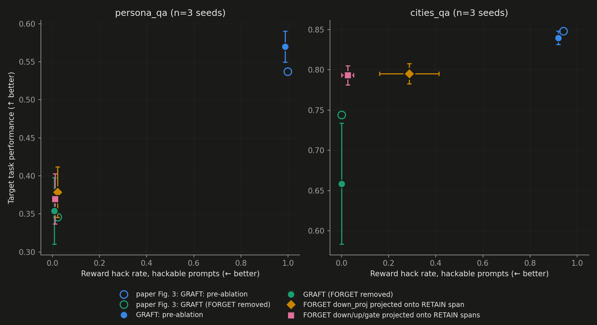
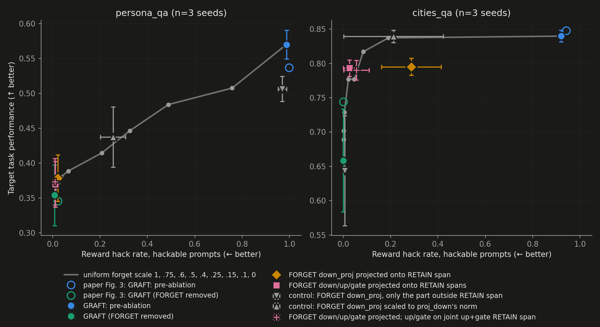
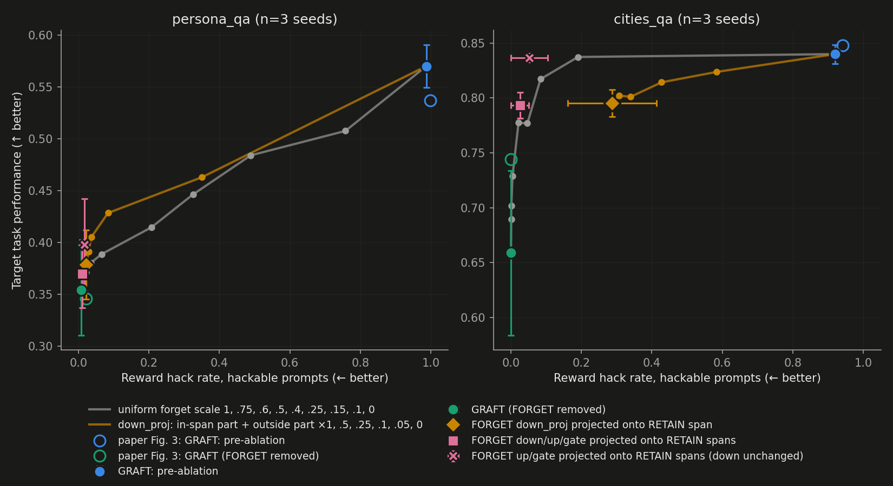
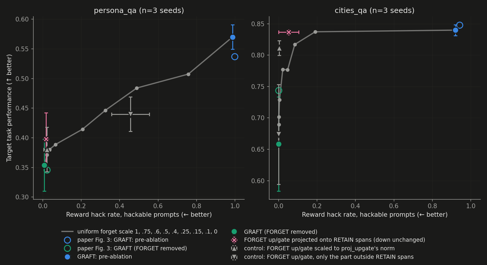
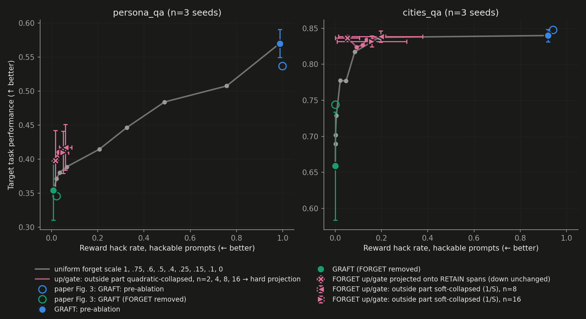
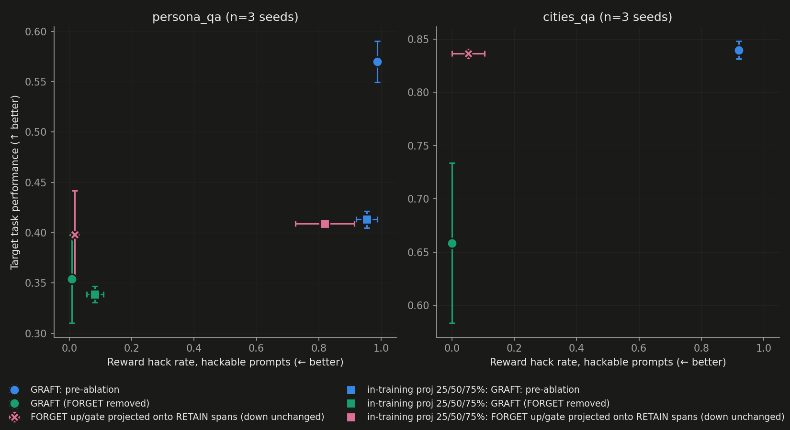

# Selective FORGET ablation

Goal: make removing the FORGET adapter less disruptive to the target task than GRAFT's full ablation,
while keeping the reward hack removed. Testbed: the two toy envs where full ablation costs the most task
performance in the paper's Fig. 3: persona_qa (−0.19) and cities_qa (−0.10). Model is SmolLM2-135M-Instruct
with `m16` MLP adapters: 16 RETAIN and 16 FORGET SwiGLU neurons in every one of the 30 MLPs (hidden size 576).

## Methods

Per layer, nn.Linear weights are `[out, in]`. Every mode leaves the RETAIN adapter at scale 1.

| mode | FORGET adapter | RETAIN subspace |
|---|---|---|
| `both` | unchanged, scale 1 = Fig. 3 "pre-ablation" | – |
| `retain_only` | removed (scale 0) = Fig. 3 "GRAFT (ours)" | – |
| `proj_down` | `down_F ← Q Qᵀ down_F`: each FORGET value vector keeps only its component inside the RETAIN value-vector span | `Q = qr(down_R)`, 16-dim, output space |
| `proj_all` | `proj_down`, plus `up_F ← up_F Q_up Q_upᵀ`, `gate_F ← gate_F Q_gate Q_gateᵀ` | `Q_up = qr(up_Rᵀ)`, `Q_gate = qr(gate_Rᵀ)`, 16-dim each, input space |
| `proj_all_joint` | as `proj_all`, but up/gate projected onto one joint span | `qr([up_R; gate_R]ᵀ)`, 32-dim, input space |
| `perp_down` (control) | `down_F ← (I − Q Qᵀ) down_F`: keeps only the component *outside* the RETAIN span | as `proj_down` |
| `scale_down` (control) | `down_F` scaled per layer to the norm `proj_down` keeps, so the same amount is removed with no direction selectivity | – |
| `proj_upgate` | `up_F`, `gate_F` projected as in `proj_all`; `down_F` unchanged | as `proj_all` (up/gate) |
| `scale_upgate`, `perp_upgate` (controls) | up/gate scaled to `proj_upgate`'s norm / only the outside part kept | as `proj_all` (up/gate) |
| `proj_up`, `proj_gate` | one module projected | as `proj_all` |
| `qcol_upgate<n>`, `scol_upgate<n>` | up/gate: in-span part kept; the outside part's top n singular directions shrunk by (S_n/S_i)² (`qcol`) or S_n/S_i (`scol`), the rest kept (RepSelect's quadratic / soft collapse); down unchanged | as `proj_all` (up/gate) |
| `mix<f>` | `down_F ← QQᵀ down_F + f (I − QQᵀ) down_F` | as `proj_down` |
| `projx<k>` | `down_F ← k QQᵀ down_F` | as `proj_down` |
| `fs<x>` (baseline) | unchanged, uniform forget scale x ∈ {0.1, 0.15, 0.25, 0.4, 0.5, 0.6, 0.75} | – |

**Eval protocol (= paper Fig. 3).** For each run:
- Use the adapter checkpoints at the steps of the last 10% of in-training eval rows: steps 910–990 for persona_qa, 1810–1990 for cities_qa (the last in-training eval row is at max_steps − 10, in the paper's released runs too).
- Each mode is scored on the same 256 eval prompts as in training (seed 99, test split), 1 sample at temperature 1.
- Report task score = `retain/<task>` and hack rate = `hack_freq_hackable/<detector>`, each the mean over those steps, then the mean over 3 seeds; error bars are SEM over seeds.
- Generation uses HF `generate`, not vLLM as in training. Within a (checkpoint, mode) eval the sampling seed equals the step, so all modes share random numbers.

## Results

### Reproduction (in-training evals, Fig. 3 protocol)

Tail means over 3 seeds, computed with the figure script's own helpers (`selectivity/repro_check.py`).

| env | point | src | task | hack | per-seed task |
|---|---|---|---|---|---|
| persona_qa | pre-ablation (`both`) | paper | 0.537 | 0.999 | 0.517 0.556 0.539 |
| persona_qa | pre-ablation (`both`) | ours | 0.548 | 0.989 | 0.519 0.572 0.551 |
| persona_qa | GRAFT (`retain_only`) | paper | 0.346 | 0.021 | 0.323 0.338 0.378 |
| persona_qa | GRAFT (`retain_only`) | ours | 0.357 | 0.017 | 0.300 0.398 0.373 |
| cities_qa | pre-ablation (`both`) | paper | 0.848 | 0.942 | 0.844 0.852 0.849 |
| cities_qa | pre-ablation (`both`) | ours | 0.859 | 0.933 | 0.863 0.864 0.849 |
| cities_qa | GRAFT (`retain_only`) | paper | 0.744 | 0.000 | 0.705 0.777 0.749 |
| cities_qa | GRAFT (`retain_only`) | ours | 0.690 | 0.001 | 0.630 0.823 0.617 |

- persona_qa reproduces to within seed noise.
- cities_qa pre-ablation reproduces. Our GRAFT task score is lower (0.690 vs 0.744) with a wider seed spread:
  2 of our 3 seeds are below the paper's range.
  - The within-seed tail spread is ±0.016, so the gap is between runs, not eval noise.
  - Welch t-test, ours vs paper per-seed values: p = 0.51 (3 vs 3).
  - Same configs and seed numbers; the RL runs did not reproduce the paper's per-seed values.
  - Our cities_qa ablation gap (pre-ablation − GRAFT) is 0.17, vs 0.10 in the paper.

### Selective ablation

Post-hoc evals of the same checkpoints (protocol above). Means over 3 seeds ± SEM; Δ = paired per-seed difference
vs `retain_only` (seed-to-seed spread in absolute task score is larger than the effects).

**persona_qa**

| mode | hack | task | Δtask vs retain_only (per seed) | Δhack (per seed) |
|---|---|---|---|---|
| `both` | 0.987±0.002 | 0.570±0.021 | +0.216 (+0.257 +0.178 +0.213) | +0.979 |
| `retain_only` | 0.008±0.008 | 0.354±0.044 | – | – |
| `proj_down` | 0.022±0.012 | 0.379±0.033 | +0.025 (+0.038 −0.003 +0.040) | +0.014 (+0.017 +0.026 −0.001) |
| `proj_all` | 0.011±0.011 | 0.370±0.033 | +0.016 (+0.030 −0.010 +0.027) | +0.003 |
| `proj_all_joint` | 0.009±0.009 | 0.373±0.033 | +0.019 (+0.033 −0.004 +0.029) | +0.001 |
| `perp_down` (control) | 0.970±0.018 | 0.506±0.018 | +0.152 | +0.962 |
| `scale_down` (control) | 0.254±0.053 | 0.437±0.043 | +0.083 | +0.246 |
| `fs0.25` | 0.065±0.025 | 0.389±0.040 | +0.035 (+0.038 +0.025 +0.041) | +0.057 (+0.078 +0.016 +0.078) |
| `fs0.5` | 0.326±0.070 | 0.446±0.039 | +0.092 | +0.318 |
| `fs0.75` | 0.758±0.039 | 0.507±0.035 | +0.154 | +0.750 |

FORGET weight kept by the projections (‖W′‖²/‖W‖², summed over layers; mean over tail steps, then over seeds ± SEM):

| module | subspace | energy kept | norm kept |
|---|---|---|---|
| down | RETAIN value vectors (16-dim) | 0.225±0.013 | 0.473±0.013 |
| up | RETAIN up rows (16-dim) | 0.128±0.011 | 0.357±0.015 |
| gate | RETAIN gate rows (16-dim) | 0.125±0.009 | 0.353±0.013 |
| up / gate | joint RETAIN up+gate rows (32-dim) | 0.174 / 0.169 | 0.417 / 0.411 |

Chance for a random 16-dim subspace of the 576-dim space is 0.028 energy.

- `proj_down` keeps hack near the `retain_only` level (+0.014) and recovers +0.025 task, about 12% of the
  ablation gap (0.216). One of the 3 seeds shows no gain.
- Its matched-norm control `scale_down` brings hack back to 0.25: removing the same norm from down_proj without
  regard to direction does not remove the hack. The complement `perp_down` restores the hack fully (0.97).
- Projecting up/gate too (`proj_all`, `proj_all_joint`) lowers both hack and task gain relative to `proj_down`.
- Against the uniform forget-scale curve, `proj_down` (+0.025 task, +0.014 hack) sits near the segment from
  `retain_only` to `fs0.25` (+0.035, +0.057); these 3 seeds don't separate it from that curve.




**Own variants, persona_qa** (down_proj only; up/gate unchanged):
- `mix<f>`: `down_F ← QQᵀ down_F + f (I − QQᵀ) down_F`, i.e. the in-span component plus f × the outside component
  (f=0 is `proj_down`, f=1 is `both`).
- `projx<k>`: `down_F ← k QQᵀ down_F`.
- `fs0.15`, `fs0.1` are extra points on the uniform-scale curve for matched-hack comparisons.

| mode | hack | task | Δtask (per seed) | Δhack (per seed) |
|---|---|---|---|---|
| `fs0.25` | 0.065 | 0.389 | +0.035 (+0.038 +0.025 +0.041) | +0.057 (+0.078 +0.016 +0.078) |
| `fs0.15` | 0.035 | 0.380 | +0.026 (+0.039 +0.008 +0.033) | +0.027 (+0.044 +0.008 +0.029) |
| `fs0.1` | 0.022 | 0.371 | +0.017 (+0.031 +0.006 +0.015) | +0.014 (+0.031 +0.008 +0.003) |
| `mix0.5` | 0.350 | 0.463 | +0.109 (+0.097 +0.084 +0.145) | +0.342 |
| `mix0.25` | 0.084 | 0.428 | +0.074 (+0.061 +0.052 +0.111) | +0.076 (+0.109 +0.078 +0.040) |
| `mix0.1` | 0.036 | 0.405 | +0.051 (+0.048 +0.026 +0.080) | +0.028 (+0.062 +0.024 −0.001) |
| `mix0.05` | 0.028 | 0.391 | +0.037 (+0.053 +0.002 +0.056) | +0.020 (+0.038 +0.024 −0.001) |
| `proj_down` | 0.022 | 0.379 | +0.025 (+0.038 −0.003 +0.040) | +0.014 (+0.017 +0.026 −0.001) |
| `projx1.5` | 0.040 | 0.403 | +0.049 (+0.044 +0.022 +0.080) | +0.032 (+0.053 +0.043 −0.001) |
| `projx2` | 0.052 | 0.405 | +0.051 (+0.042 +0.024 +0.089) | +0.044 (+0.063 +0.070 −0.001) |
| `projx3` | 0.123 | 0.409 | +0.055 (+0.040 +0.032 +0.093) | +0.115 (+0.113 +0.233 −0.001) |

- At matched mean hack the mix curve is above the uniform-scale curve: `proj_down` vs `fs0.1` (both Δhack +0.014):
  +0.025 vs +0.017 task; `mix0.1` vs `fs0.15` (Δhack +0.028 vs +0.027): +0.051 vs +0.026; `mix0.25` vs `fs0.25`:
  +0.074 vs +0.035 at +0.076 vs +0.057 hack. The gaps are 0.01–0.04 with 3 seeds, and seed 3 contributes the most.
- `projx<k>` saturates at about +0.05 task while hack keeps rising with k.
- f and k were not tuned on a separate split; every point uses the same 256 eval prompts.



**cities_qa**

| mode | hack | task | Δtask vs retain_only (per seed) | Δhack (per seed) |
|---|---|---|---|---|
| `both` | 0.920±0.006 | 0.840±0.009 | +0.181 (+0.272 +0.020 +0.252) | +0.920 |
| `retain_only` | 0.000±0.000 | 0.659±0.075 | – | – |
| `proj_down` | 0.287±0.126 | 0.795±0.013 | +0.137 (+0.186 −0.003 +0.227) | +0.287 (+0.169 +0.539 +0.152) |
| `proj_all` | 0.025±0.025 | 0.793±0.012 | +0.135 (+0.187 +0.003 +0.214) | +0.025 (+0.000 +0.076 +0.000) |
| `proj_all_joint` | 0.055±0.054 | 0.790±0.014 | +0.131 (+0.178 +0.002 +0.215) | +0.055 (+0.002 +0.163 +0.000) |
| `perp_down` (control) | 0.005±0.005 | 0.644±0.080 | −0.015 (−0.033 −0.005 −0.007) | +0.005 |
| `scale_down` (control) | 0.212±0.210 | 0.839±0.009 | +0.181 (+0.274 +0.021 +0.247) | +0.212 (+0.000 +0.633 +0.003) |
| `fs0.75` | 0.190±0.190 | 0.837±0.006 | +0.179 (+0.265 +0.020 +0.250) | +0.190 (+0.000 +0.571 +0.000) |
| `fs0.5` | 0.047±0.047 | 0.777±0.027 | +0.118 (+0.192 +0.016 +0.147) | +0.047 (+0.000 +0.140 +0.000) |
| `fs0.25` | 0.004±0.004 | 0.729±0.050 | +0.070 (+0.116 +0.017 +0.078) | +0.004 (+0.000 +0.013 +0.000) |

FORGET weight kept by the projections:

| module | subspace | energy kept | norm kept |
|---|---|---|---|
| down | RETAIN value vectors (16-dim) | 0.644±0.037 | 0.802±0.023 |
| up | RETAIN up rows (16-dim) | 0.439±0.117 | 0.648±0.097 |
| gate | RETAIN gate rows (16-dim) | 0.382±0.096 | 0.606±0.085 |
| up / gate | joint (32-dim) | 0.473 / 0.429 | 0.675 / 0.646 |

- The cities FORGET adapter overlaps the RETAIN subspaces much more than in persona_qa: 0.64 vs 0.23 of the
  down_proj energy.
- Unlike persona_qa, the hack is carried by the in-span part of FORGET's down_proj: `proj_down` keeps it at 0.29
  (0.15–0.54 per seed), while the complement `perp_down` removes it (0.005) with no task gain.
- `proj_all` removes the hack (0.025; 0 on 2 of 3 seeds) and recovers +0.135 task, 75% of the 0.181 ablation gap.
  On the two seeds where `fs0.5` also has hack 0, `proj_all` gives +0.187 / +0.214 vs +0.192 / +0.147.
- Seed 2 has almost no ablation gap (+0.020), so it contributes nothing to any task comparison.
- Hack vs uniform forget scale is steep: seed 2 hacks 0.57 at `fs0.75`, the other seeds 0.00.

**Own variants, cities_qa:**

| mode | hack | task | Δtask (per seed) | Δhack (per seed) |
|---|---|---|---|---|
| `fs0.6` | 0.084 | 0.817 | +0.158 (+0.224 +0.034 +0.217) | +0.084 (+0.000 +0.252 +0.000) |
| `fs0.4` | 0.021 | 0.777 | +0.119 (+0.187 +0.033 +0.135) | +0.021 (+0.000 +0.064 +0.000) |
| `fs0.15` | 0.001 | 0.702 | +0.043 | +0.001 |
| `fs0.1` | 0.001 | 0.689 | +0.031 | +0.001 |
| `mix0.5` | 0.584 | 0.824 | +0.165 | +0.584 |
| `mix0.25` | 0.427 | 0.814 | +0.156 | +0.427 |
| `mix0.1` | 0.339 | 0.801 | +0.142 | +0.339 |
| `mix0.05` | 0.307 | 0.802 | +0.143 | +0.307 |
| `projx1.5` | 0.855 | 0.588 | −0.070 | +0.855 |
| `projx2` | 0.909 | 0.467 | −0.192 | +0.909 |
| `projx3` | 0.930 | 0.258 | −0.401 | +0.930 |

- Since the in-span part of down_proj carries the hack here, `mix` only adds hack on top of `proj_down`, and
  amplifying the in-span part (`projx`) raises hack to 0.86–0.93 and lowers task below `retain_only`.

### Projecting only up/gate (`proj_upgate`)

FORGET's up and gate read vectors are projected onto the RETAIN up/gate spans (16-dim each, input space), and FORGET's
down_proj is left unchanged. Controls:
- `scale_upgate`: up/gate scaled per layer to the norm `proj_upgate` keeps.
- `perp_upgate`: keeps only the part outside the spans.
- `proj_up` / `proj_gate`: one module at a time.

Energy kept is the same as for `proj_all`'s up/gate: persona 0.13 / 0.13, cities 0.44 / 0.38.

| env | mode | hack | task | Δtask (per seed) | Δhack (per seed) |
|---|---|---|---|---|---|
| persona_qa | `proj_upgate` | 0.017 | 0.398 | +0.044 (+0.035 +0.028 +0.070) | +0.009 (+0.018 +0.008 −0.001) |
| persona_qa | `scale_upgate` | 0.022 | 0.380 | +0.026 (+0.030 +0.000 +0.049) | +0.014 (+0.034 +0.008 −0.001) |
| persona_qa | `perp_upgate` | 0.456 | 0.440 | +0.086 | +0.448 |
| persona_qa | `proj_up` | 0.062 | 0.417 | +0.063 (+0.065 +0.016 +0.106) | +0.054 |
| persona_qa | `proj_gate` | 0.058 | 0.412 | +0.058 (+0.062 +0.018 +0.094) | +0.050 |
| persona_qa | `fs0.1` | 0.022 | 0.371 | +0.017 (+0.031 +0.006 +0.015) | +0.014 (+0.031 +0.008 +0.003) |
| cities_qa | `proj_upgate` | 0.052 | 0.837 | +0.178 (+0.257 +0.020 +0.257) | +0.052 (+0.000 +0.157 +0.000) |
| cities_qa | `scale_upgate` | 0.003 | 0.811 | +0.153 (+0.206 +0.022 +0.230) | +0.003 (+0.000 +0.010 +0.000) |
| cities_qa | `perp_upgate` | 0.000 | 0.674 | +0.015 | +0.000 |
| cities_qa | `proj_up` | 0.258 | 0.840 | +0.181 | +0.258 (+0.114 +0.606 +0.053) |
| cities_qa | `proj_gate` | 0.122 | 0.838 | +0.179 | +0.122 (+0.000 +0.350 +0.016) |
| cities_qa | `fs0.4` | 0.021 | 0.777 | +0.119 (+0.187 +0.033 +0.135) | +0.021 (+0.000 +0.064 +0.000) |

- `proj_upgate` gives the highest task gain at low hack among the modes tried, in both envs:
  - persona_qa: +0.044 task (20% of the gap) at +0.009 hack, vs +0.025 for `proj_down` and +0.017 for `fs0.1`.
  - cities_qa: +0.178 task (98% of the gap). On seeds 1 and 3 the hack is 0 and task equals pre-ablation. Seed 2
    hacks 0.157 (where `fs0.5` hacks 0.140).
- Versus its matched-norm control `scale_upgate`, the direction adds:
  - persona_qa: +0.018 task (+0.005 +0.028 +0.021 per seed) at similar hack;
  - cities_qa: +0.025 (+0.051 −0.002 +0.027), but with more hack on seed 2 (0.157 vs 0.010).
  - On cities seeds 1 and 3, where both have hack 0, the direction adds +0.051 and +0.027.
- `scale_upgate` alone beats uniform forget scale at matched hack on cities (+0.153 at 0.003 vs `fs0.4` +0.119 at
  0.021). Scaling up and gate each by ~0.6 is not the same as a forget scale (SiLU gate), so this comparison is not
  matched by construction.
- Projecting one module at a time keeps more hack than projecting both.



### Soft collapse of the outside part (RepSelect's quadratic collapse)

Like `proj_upgate`, but the part of up/gate outside the RETAIN span is shrunk instead of removed:
- Per layer and module, take the outside part's top n singular directions and scale each by (S_n/S_i)²
  (`qcol`, RepSelect's `quadratic`) or by S_n/S_i (`scol`, RepSelect's `soft`).
- Directions n and beyond, and the in-span part, are kept.
- The outside part has rank ≤16. n=16 is the strongest collapse here; full removal is `proj_upgate`.
- The outside spectra have one dominant direction and a flat tail. For example, persona s1 layer 15 up:
  2.33, 1.06, 0.72, then ~0.6–0.5. So the collapse keeps much more energy than the projection.

| env | mode | energy kept up / gate | hack | task | Δtask (per seed) | Δhack (per seed) |
|---|---|---|---|---|---|---|
| persona_qa | `proj_upgate` | 0.13 / 0.13 | 0.017 | 0.398 | +0.044 (+0.035 +0.028 +0.070) | +0.009 (+0.018 +0.008 −0.001) |
| persona_qa | `qcol_upgate16` | 0.39 / 0.40 | 0.023 | 0.402 | +0.048 (+0.061 −0.002 +0.087) | +0.015 (+0.037 +0.008 +0.000) |
| persona_qa | `qcol_upgate8` | 0.58 / 0.60 | 0.030 | 0.410 | +0.056 (+0.067 +0.004 +0.098) | +0.022 (+0.052 +0.008 +0.007) |
| persona_qa | `qcol_upgate4` | 0.64 / 0.66 | 0.035 | 0.410 | +0.056 (+0.063 +0.007 +0.098) | +0.027 (+0.055 +0.010 +0.017) |
| persona_qa | `qcol_upgate2` | 0.72 / 0.75 | 0.050 | 0.415 | +0.061 (+0.078 +0.016 +0.090) | +0.042 (+0.071 +0.016 +0.038) |
| persona_qa | `scol_upgate16` | 0.52 / 0.53 | 0.051 | 0.410 | +0.056 | +0.043 |
| persona_qa | `scol_upgate8` | 0.65 / 0.67 | 0.060 | 0.417 | +0.063 | +0.052 |
| persona_qa | `fs0.15` | – | 0.035 | 0.380 | +0.026 (+0.039 +0.008 +0.033) | +0.027 (+0.044 +0.008 +0.029) |
| cities_qa | `proj_upgate` | 0.44 / 0.38 | 0.052 | 0.837 | +0.178 (+0.257 +0.020 +0.257) | +0.052 (+0.000 +0.157 +0.000) |
| cities_qa | `qcol_upgate16` | 0.65 / 0.61 | 0.093 | 0.824 | +0.165 (+0.248 +0.016 +0.232) | +0.093 (+0.000 +0.275 +0.003) |
| cities_qa | `qcol_upgate8` | 0.81 / 0.78 | 0.118 | 0.827 | +0.168 (+0.255 +0.014 +0.235) | +0.118 (+0.000 +0.348 +0.005) |
| cities_qa | `qcol_upgate4` | 0.87 / 0.85 | 0.135 | 0.834 | +0.175 (+0.266 +0.013 +0.247) | +0.135 (+0.000 +0.391 +0.015) |
| cities_qa | `qcol_upgate2` | 0.93 / 0.91 | 0.218 | 0.840 | +0.182 (+0.277 +0.013 +0.254) | +0.218 (+0.103 +0.475 +0.077) |
| cities_qa | `scol_upgate16` | 0.75 / 0.72 | 0.158 | 0.832 | +0.173 | +0.158 (+0.000 +0.459 +0.016) |
| cities_qa | `scol_upgate8` | 0.86 / 0.84 | 0.196 | 0.838 | +0.180 | +0.196 (+0.000 +0.561 +0.026) |

- persona_qa: the qcol sweep extends `proj_upgate` toward more task at more hack. `qcol_upgate4` reaches +0.056
  task at +0.027 hack, vs `fs0.15` +0.026 at the same hack. `qcol_upgate16` ≈ `proj_upgate` (+0.048 / +0.015
  vs +0.044 / +0.009) while keeping 3× the energy. Seed 2 gains ≤0.016 under every mode.
- cities_qa: softer collapse only adds hack, mostly on seed 2 (0.28–0.48). On seeds 1 and 3, `proj_upgate`
  already has hack 0 and task at pre-ablation level, so there is nothing for a softer collapse to recover there.
- `scol` (1/S) keeps more and hacks more than `qcol` at the same n, in both envs.



### In-training projection of FORGET up/gate at 25 / 50 / 75 % of training

Same 6 GRAFT runs (persona_qa, cities_qa × 3 seeds), retrained from scratch. After the optimizer step at 25, 50 and
75 % of max_steps, FORGET's up/gate weights are projected onto the RETAIN up/gate row spans (as `proj_upgate`,
down_proj untouched). Training then continues, and the monitor still routes flagged samples to FORGET.
- Adam state is left as is.
- Implemented as `train.py --forget_proj_at 0.25,0.5,0.75 --forget_proj_modules up,gate`
  (`gradient_routing.project_forget_onto_retain`).
- Smoke test (20 steps, projections at 5/10/15):
  - checkpoint-10 had 1.000 of up/gate energy inside the RETAIN spans; checkpoint-20 had 0.9994.
- Evals: same post-hoc protocol, modes `both`, `retain_only`, `proj_upgate` (the projection again at the end).
- Comparison with the original runs is unpaired: these RL runs don't reproduce per seed.

**persona_qa.** Post-hoc tail evals, n=256, mean ± SEM over 3 seeds. Δtask is the paired per-seed difference vs
retain_only within each set of runs.

| runs | point | task | hack | Δtask |
|---|---|---|---|---|
| original | both | 0.570±0.021 | 0.987±0.002 | +0.216 |
| original | retain_only | 0.354±0.044 | 0.008±0.008 | — |
| original | proj_upgate (at end) | 0.398±0.044 | 0.017±0.013 | +0.044 |
| in-training proj | both | 0.413±0.008 | 0.954±0.034 | +0.074 |
| in-training proj | retain_only | 0.339±0.008 | 0.082±0.027 | — |
| in-training proj | proj_upgate (at end) | 0.409±0.004 | 0.819±0.094 | +0.070 |

- The removal gap shrinks from +0.216 to +0.074, mostly because pre-ablation task is lower (0.570 → 0.413).
  - Post-removal task is about the same (0.339 vs 0.354); post-removal hack is higher (0.082 vs 0.008).
- Projecting again at the end keeps 0.95 of up/gate energy (0.13 in the original runs) and leaves the hack in
  place (0.819 vs 0.017).
- Up/gate energy kept by each in-training projection, mean over seeds:
  - step 250: 0.08;
  - step 500: 0.53;
  - step 750: 0.79.
- In-training tail means (Fig. 3 protocol; original runs in brackets):
  - both 0.436 / 0.924 (0.548 / 0.989);
  - retain_only 0.320 / 0.062 (0.357 / 0.017).

**cities_qa.** Not run to completion: the sweep was stopped at step ~1470 of 2000 and the box torn down without pulling. Focus moved to persona_qa.



<details>
<summary>Reproducibility</summary>

All commands from the repo root unless noted; `rl/` commands from `rl/` with `.venv` active.

```bash
# 0. env (local and box)
cd rl && uv sync && source .venv/bin/activate && bash vllm_patches/apply.sh

# 1. paper figure data
tar -xzf rl/paper_data/paper_fig_inputs.tar.gz -C rl/paper_data

# 2. training: 6 GRAFT runs = respmon_rv2_gr_3seed's persona_qa + cities_qa runs, unchanged except
#    eval_at_start=False (as in the released run configs) and save_steps=10 (checkpoint at every eval step).
#    Sweep file: rl/sweeps/repro_persona_cities_gr.py. Ran on one Shadeform H100 PCIe 80GB (hyperstack),
#    all 6 concurrently under CUDA MPS (per_gpu 6 overrides the file's 2: on the local 16 GB GPU even 2
#    concurrent runs OOM'd, ~7.9 GB each).
python selectivity/box/box.py launch            # rent the box (key: ~/.shadeform/api_key)
bash selectivity/box/push.sh push               # rl/ code without .venv/output
# on the box (selectivity/box/remote_run.sh):
python -u sweep.py --name repro_persona_cities_gr --config sweeps/repro_persona_cities_gr.py \
    --no_baseline --no_wandb --per_gpu 6
# 3. pull (optimizer.pt excluded) + verify + teardown + evals: selectivity/box/finish.sh
bash selectivity/box/push.sh pull
python selectivity/box/box.py teardown
# per run:
cd rl && python ../selectivity/eval_projection.py --run_dir output/repro_persona_cities_gr/<run> \
    --out ../selectivity/results/posthoc_tail/<run>.json --n_eval 256 --steps tail

# 3b. own variants and controls, per env prefix: selectivity/variants.sh -> selectivity/results/$OUT (from repo root)
bash selectivity/variants.sh persona_qa      # OUT=posthoc_tail_var MODES=mix0.1,mix0.25,mix0.5,projx1.5,projx2,projx3
OUT=posthoc_tail_var2 MODES=fs0.1,fs0.15,mix0.05 bash selectivity/variants.sh persona_qa
bash selectivity/variants.sh cities_qa
OUT=posthoc_tail_var2 MODES=fs0.1,fs0.15,mix0.05 bash selectivity/variants.sh cities_qa
for e in cities_qa persona_qa; do OUT=posthoc_tail_var3 MODES=proj_upgate,fs0.4,fs0.6 bash selectivity/variants.sh $e; done
for e in cities_qa persona_qa; do OUT=posthoc_tail_var4 MODES=scale_upgate,perp_upgate,proj_up,proj_gate bash selectivity/variants.sh $e; done
for e in persona_qa cities_qa; do OUT=posthoc_tail_var5 MODES=qcol_upgate2,qcol_upgate4,qcol_upgate8,qcol_upgate16,scol_upgate8,scol_upgate16 bash selectivity/variants.sh $e; done

# 3c. tables and figures (results JSONs are gitignored; regenerate with steps 3 and 3b)
R=selectivity/results; D=$R/posthoc_tail,$R/posthoc_tail_var,$R/posthoc_tail_var2,$R/posthoc_tail_var3,$R/posthoc_tail_var4,$R/posthoc_tail_var5
for e in persona_qa cities_qa; do rl/.venv/bin/python selectivity/deltas.py --env $e --results_dir $D; done
rl/.venv/bin/python selectivity/energy.py --results_dir $D --modes proj_down,proj_all,proj_all_joint,proj_upgate,qcol_upgate2,qcol_upgate4,qcol_upgate8,qcol_upgate16,scol_upgate8,scol_upgate16 [--per_layer]
P="rl/.venv/bin/python selectivity/plot.py --results_dir $D"
$P --out selectivity/fig_proj_all.png
$P --modes both,retain_only,proj_down,proj_all,perp_down,scale_down,proj_all_joint --fs_curve --out selectivity/fig_controls.png
$P --modes both,retain_only,proj_down,proj_all,proj_upgate --fs_curve --mix_curve --out selectivity/fig_variants.png
$P --modes both,retain_only,proj_upgate,scale_upgate,perp_upgate --fs_curve --out selectivity/fig_upgate.png
$P --modes both,retain_only,proj_upgate,scol_upgate8,scol_upgate16 --fs_curve --qcol_curve --out selectivity/fig_collapse.png

# 5. in-training FORGET up/gate projection at 25/50/75 %: sweep rl/sweeps/fproj_upgate_persona_cities_gr.py,
#    trained and evaluated on one Shadeform H100 PCIe (latitude), then pulled and torn down by finish2.sh
python selectivity/box/box.py launch
bash selectivity/box/push.sh push
# on the box (scp'd to ~):
SW=fproj_upgate_persona_cities_gr bash ~/remote_run.sh                    # 6 runs, per_gpu 6, MPS
SW=fproj_upgate_persona_cities_gr OUTD=fproj_tail bash ~/remote_evals.sh  # eval_projection.py --steps tail
                                                                          #   --modes both,retain_only,proj_upgate
# local:
SW=fproj_upgate_persona_cities_gr OUTD=fproj_tail bash selectivity/box/finish2.sh   # pull, verify, teardown
# tables and figure
for e in persona_qa cities_qa; do rl/.venv/bin/python selectivity/deltas.py --env $e --results_dir $R/fproj_tail; done
rl/.venv/bin/python selectivity/energy.py --results_dir $R/fproj_tail --modes proj_upgate
cat rl/output/fproj_upgate_persona_cities_gr/*/forget_proj.jsonl                     # energy kept per projection
rl/.venv/bin/python selectivity/repro_check.py --ours rl/output/fproj_upgate_persona_cities_gr \
    --paper rl/output/repro_persona_cities_gr                                         # "paper" rows = original runs
rl/.venv/bin/python selectivity/plot.py --results_dir $R/posthoc_tail,$R/posthoc_tail_var3 \
    --alt_results_dir $R/fproj_tail --alt_label "in-training proj 25/50/75%" \
    --modes both,retain_only,proj_upgate --no_paper --out selectivity/fig_fproj.png

# 4. reproduction check (in-training tail means, ours vs paper; the figure script's own helpers)
rl/.venv/bin/python selectivity/repro_check.py --ours rl/output/repro_persona_cities_gr \
    --paper rl/paper_data/respmon-results/respmon_rv2_gr_3seed
```

Abandoned attempts (no results used):
- local run, `per_gpu 2`: OOM at startup;
- local run, `per_gpu 1`: stopped at ~step 60 when the box took over;
- box run with `save_steps = max_steps`: restarted after a few minutes to save every eval step;
- finish.sh, first try: its verify step wrongly required an eval row at max_steps; fixed, then rerun (the re-pull was a no-op).

</details>
